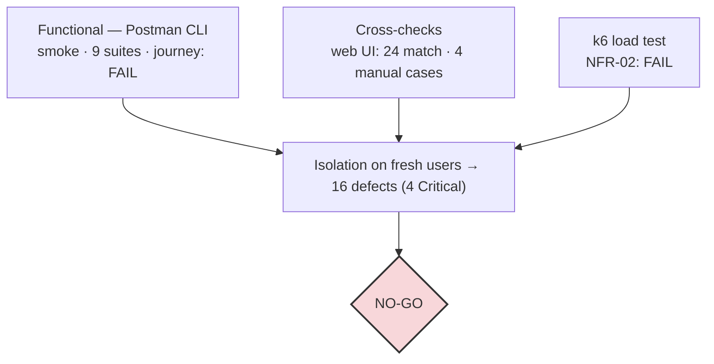
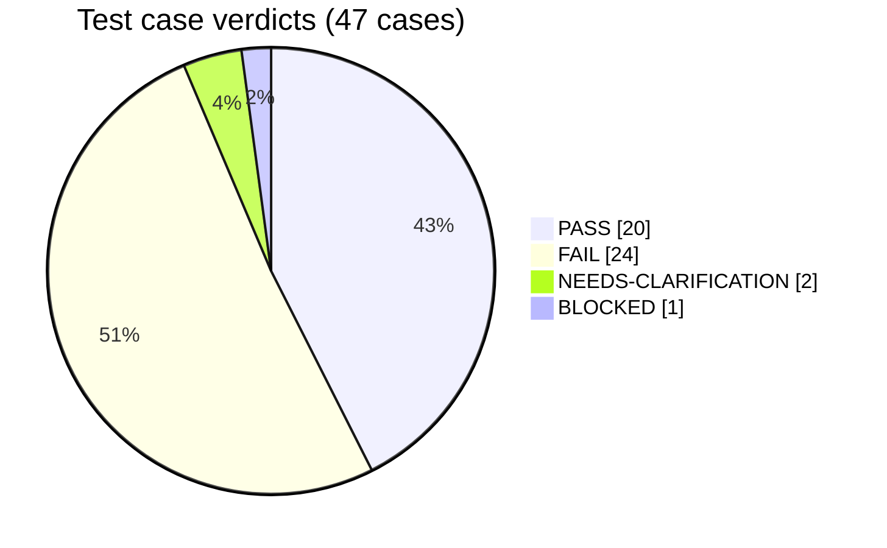
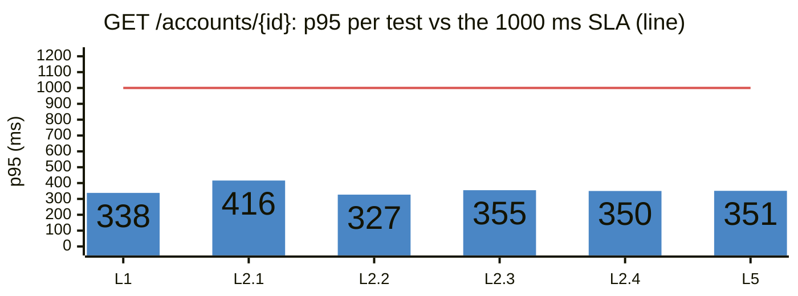
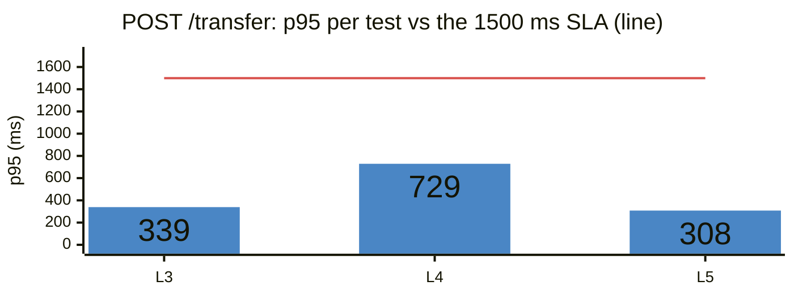
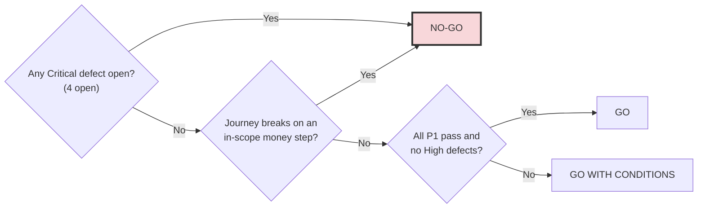
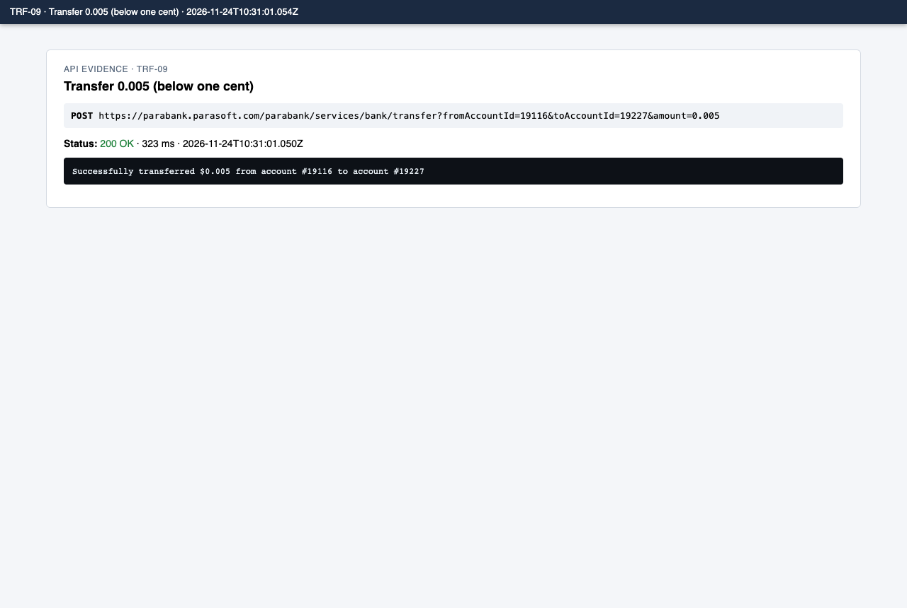
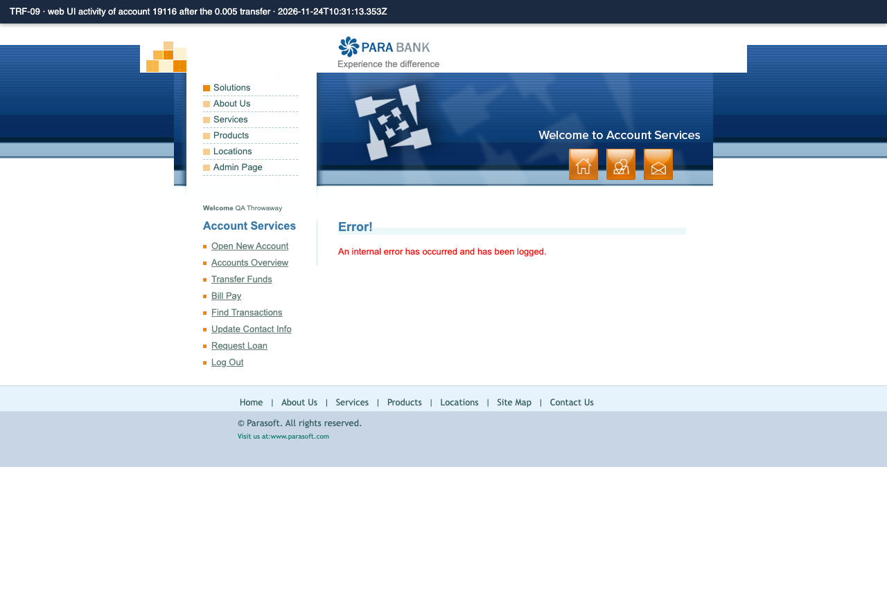
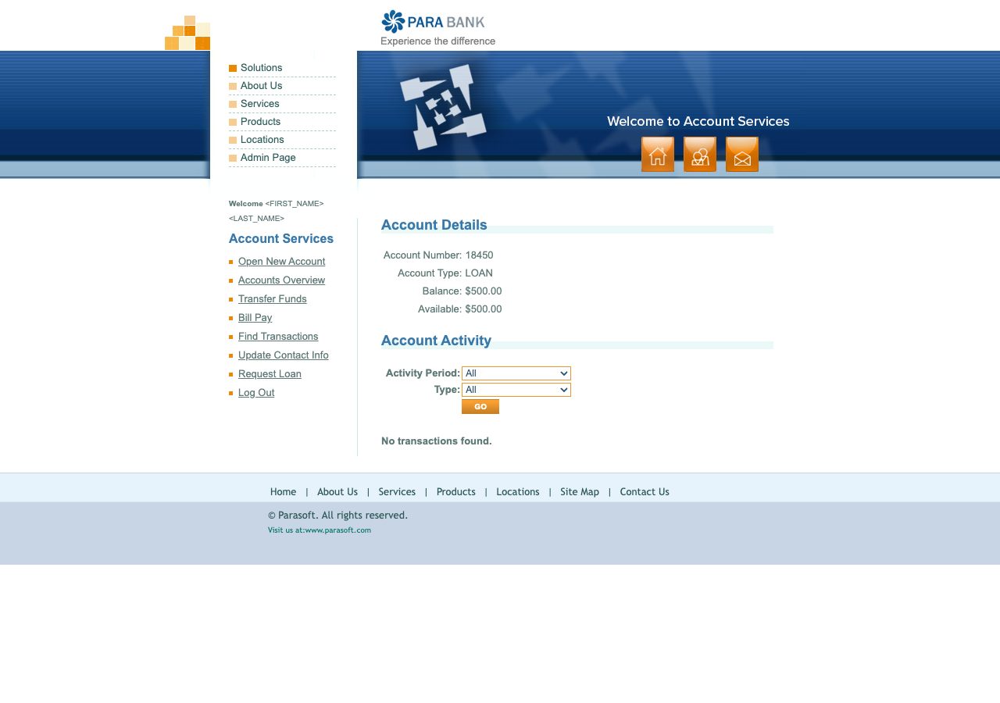
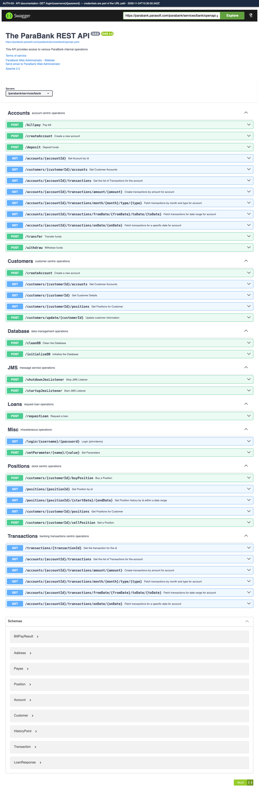
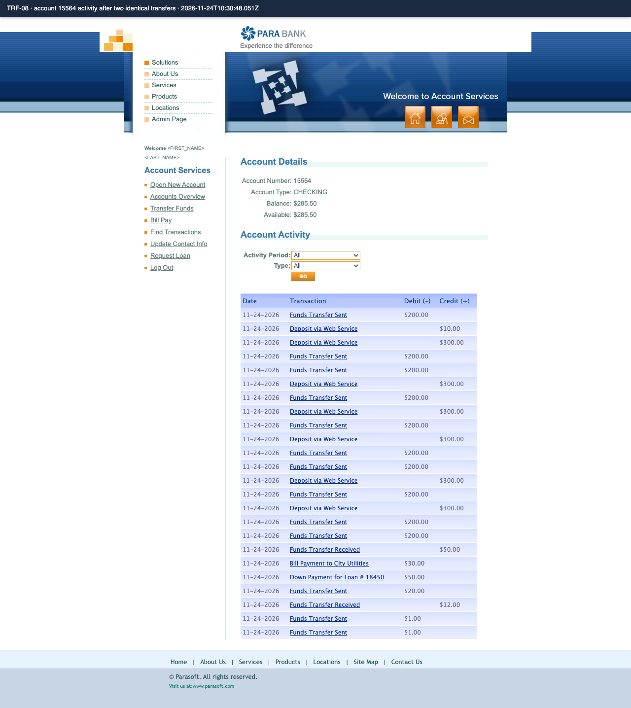

# Test Summary Report (STR) — detailed annex

*The two-page report for R&D and management is [STR.md](STR.md); this annex holds the full results, charts, reproduction steps and evidence behind it.*

**Candidate:** Roy Kazes  
**Date:** 2026-11-24  
**System under test:** ParaBank REST API — `https://parabank.parasoft.com/parabank/services/bank` (public sandbox)  
**Audience:** R&D and management  
**Test cycle:** API [`2026-11-24T10-25-10Z-api`](results/kept/2026-11-24T10-25-10Z-api/summary.md) · UI [`2026-11-24T10-29-47Z-ui`](results/kept/2026-11-24T10-29-47Z-ui/summary.md) · manual [`2026-11-24T10-30-26Z-manual`](results/kept/2026-11-24T10-30-26Z-manual/summary.md) · load [`2026-11-24T08-22-10Z-load`](results/kept/2026-11-24T08-22-10Z-load/summary.md)  
**Related documents:** [Test design (STD)](STD.md) · [Bug reports](Bug_Reports.md) · [Business rules](Business_Rules.md) · [Load test plan](tests/load/load_test_plan.md) · [All runs](results/index.md) · [Verdict history](results/history.md)

## 1. Executive summary

We tested the ParaBank REST API with 47 designed test cases, in five layers:
- a smoke gate;
- nine endpoint suites;
- a 16-step customer journey;
- web UI cross-checks and manual tests;
- a k6 load test.

**Results:** 20 cases passed and 24 failed, and the customer journey failed. 16 defects are open, 4 of them Critical:
- transfer of 0.005 is accepted and makes both accounts and the customer's account list unreadable (500) ([BUG-001](Bug_Reports.md#bug-001));
- no authentication: anyone can read a customer's profile (incl. SSN) and accounts, and move their money ([BUG-002](Bug_Reports.md#bug-002));
- negative amounts are accepted and move money in the opposite direction ([BUG-003](Bug_Reports.md#bug-003));
- concurrent transfers from the same account lose debits: money is created (found by the load test) ([BUG-016](Bug_Reports.md#bug-016)).

**Recommendation: NO-GO** — the API is not ready to handle real money. It needs the Critical defects fixed and a clean re-run of this cycle first.

## 2. Scope: what was and was not tested

| Area | Tested? | Notes |
|---|---|---|
| In-scope endpoints: login, customer, accounts, account, transfer, deposit, withdraw, bill pay, request loan, transactions and filters | **Yes** | Positive, negative, boundary, security and data-integrity cases, each suite on fresh accounts ([STD §5](STD.md)) |
| Extended endpoints: open account, buy/sell positions, update profile | Partly | Checked by journey steps J06, J14–J16, with no dedicated suite |
| End-to-end customer journey (JRN-01) | **Yes** | J02–J17 in one run; failing steps isolated to endpoints ([Bug reports: failure classification](Bug_Reports.md#failure-classification-stage-4-exit-gate)) |
| Web UI | Cross-check only | Overview and activity pages compared with the API ([UI run](results/kept/2026-11-24T10-29-47Z-ui/summary.md)); no UI functional testing |
| Security | Basic | Missing authentication, password in the URL, injection (blocked by the site firewall, so not tested) |
| Performance | **Yes** (small) | `GET /accounts/{id}` and `POST /transfer` only, ≤ 10 VUs ([load test plan](tests/load/load_test_plan.md)) |
| Concurrency of other writes (deposit, withdraw, bill pay) | No | Only transfer was load-tested |
| Admin endpoints (`/cleanDB`, `/initializeDB`, `/setParameter`, JMS) | No | Excluded: they affect every user of the shared site; a guard blocks them |
| Other customers' data | No | Only our own and throwaway users; the access gap (BUG-002) was shown on our own customer |

## 3. Results

| Total test cases | Executed | Passed | Failed | Blocked | Not run |
|---|---|---|---|---|---|
| 47 | 46 | 20 | 24 | 1 | 0 |

*Executed* includes 2 NEEDS-CLARIFICATION: the case ran, but the expected behavior is not defined, so it is a question for R&D. Verdicts come from:
- the API run (Postman CLI);
- the manual run (AUTH-03, AUTH-05, TRF-08, TRF-09);
- the load run (NFR-02).

| Area | Designed | Passed | Failed | Needs clarification | Blocked | Not run |
|---|---|---|---|---|---|---|
| Login (AUTH) | 5 | 3 | 1 | 0 | 1 | 0 |
| Customer (CUST) | 3 | 2 | 1 | 0 | 0 | 0 |
| Accounts (ACCT) | 5 | 4 | 1 | 0 | 0 | 0 |
| Transfer (TRF) | 10 | 3 | 6 | 1 | 0 | 0 |
| Deposit (DEP) | 3 | 1 | 2 | 0 | 0 | 0 |
| Withdraw (WDR) | 4 | 1 | 3 | 0 | 0 | 0 |
| Bill pay (BILL) | 4 | 1 | 3 | 0 | 0 | 0 |
| Loan (LOAN) | 4 | 1 | 2 | 1 | 0 | 0 |
| Transactions & filters (HIST) | 6 | 3 | 3 | 0 | 0 | 0 |
| Customer journey (JRN) | 1 | 0 | 1 | 0 | 0 | 0 |
| Non-functional (NFR) | 2 | 1 | 1 | 0 | 0 | 0 |

**Customer journey:**
- JRN-01 FAIL, with 91/94 checks passing.
- Failing steps: J06b, J13a, J13e. Each was isolated to an endpoint defect (BUG-009, BUG-015, BUG-006).
- The money steps (deposit, transfer, bill pay) reconciled.

**UI cross-check:** 24 checks match the API, 0 mismatch, and 1 rule is not met (A12: the loan is missing from the history in the UI as well as the API).

**Coded tests (pytest + requests):** 4 passed, 2 failed only on known defects, 0 new failures, 0 known defects no longer reproducing. They are an independent second implementation of JRN-01, TRF-01, TRF-03, DEP-01 and ACCT-03 ([run](results/kept/2026-11-24T09-10-37Z-auto/summary.md) · [README](tests/automation/README.md)).

**Full results:**
- per-case table: [API run summary](results/kept/2026-11-24T10-25-10Z-api/summary.md);
- manual evidence: [manual run](results/kept/2026-11-24T10-30-26Z-manual/summary.md);
- trend across runs: [verdict history](results/history.md).

## 4. Defects

All 16 defects are open; none has been fixed or retested after a fix. Each was reproduced on a fresh throwaway customer next to a control input that works.

| Severity | Open | Fixed/Closed | Examples (ID and title) |
|---|---|---|---|
| Critical | 4 | 0 | [BUG-001](Bug_Reports.md#bug-001) Transfer of 0.005 is accepted and makes both accounts and the customer's account list unreadable (500) [BUG-002](Bug_Reports.md#bug-002) No authentication: anyone can read a customer's profile (incl. SSN) and accounts, and move their money [BUG-003](Bug_Reports.md#bug-003) Negative amounts are accepted and move money in the opposite direction + 1 more |
| High | 5 | 0 | [BUG-004](Bug_Reports.md#bug-004) Transfer, withdraw and bill pay accept amounts above the balance (unlimited overdraft) [BUG-005](Bug_Reports.md#bug-005) Loan is approved with a down payment larger than the source account balance; the account goes negative [BUG-006](Bug_Reports.md#bug-006) Approved loan is not recorded in the loan account's transaction history + 2 more |
| Medium | 7 | 0 | [BUG-009](Bug_Reports.md#bug-009) `createAccount` response shows balance 0 while the new account holds 100.00 [BUG-010](Bug_Reports.md#bug-010) Zero amounts are accepted and recorded as 0.00 transactions [BUG-011](Bug_Reports.md#bug-011) Transfer to the same account is accepted and recorded + 4 more |
| Low | 0 | 0 | — |

**Full list:** every defect, with its evidence and the command that reproduces it. Last re-verified: Stage 4, 2026-11-23 16:52 UTC.

| ID | Sev. | Prio. | Title | Detected by | Evidence | Reproduce |
|---|---|---|---|---|---|---|
| [BUG-001](Bug_Reports.md#bug-001) | Critical | P1 | Transfer of 0.005 is accepted and makes both accounts and the customer's account list unreadable (500) | TRF-09 | [bundle](evidence/bugs/BUG-001/repro.md) | `./run.sh repro` · `./run.sh manual TRF-09` |
| [BUG-002](Bug_Reports.md#bug-002) | Critical | P1 | No authentication: anyone can read a customer's profile (incl. SSN) and accounts, and move their money | CUST-03, ACCT-04 | [bundle](evidence/bugs/BUG-002/repro.md) | `./run.sh repro` |
| [BUG-003](Bug_Reports.md#bug-003) | Critical | P1 | Negative amounts are accepted and move money in the opposite direction | TRF-03, DEP-03, WDR-03, BILL-04 | [bundle](evidence/bugs/BUG-003/repro.md) | `./run.sh repro` |
| [BUG-016](Bug_Reports.md#bug-016) | Critical | P1 | Concurrent transfers from the same account lose debits: money is created (found by the load test) | NFR-02 (L4, L6) | [bundle](evidence/bugs/BUG-016/repro.md) | `./run.sh load` (L4) · `node --env-file=.env tests/load/isolate-concurrency.mjs` |
| [BUG-004](Bug_Reports.md#bug-004) | High | P1 | Transfer, withdraw and bill pay accept amounts above the balance (unlimited overdraft) | TRF-02, WDR-02, BILL-02 | [bundle](evidence/bugs/BUG-004/repro.md) | `./run.sh repro` |
| [BUG-005](Bug_Reports.md#bug-005) | High | P1 | Loan is approved with a down payment larger than the source account balance; the account goes negative | LOAN-04 | [bundle](evidence/bugs/BUG-005/repro.md) | `./run.sh repro` |
| [BUG-006](Bug_Reports.md#bug-006) | High | P2 | Approved loan is not recorded in the loan account's transaction history | LOAN-01, JRN-01 J13e | [bundle](evidence/bugs/BUG-006/repro.md) | `./run.sh repro` |
| [BUG-007](Bug_Reports.md#bug-007) | High | P2 | Bill pay with an empty payee is accepted and takes the money ("Bill Payment to null") | BILL-03 | [bundle](evidence/bugs/BUG-007/repro.md) | `./run.sh repro` |
| [BUG-008](Bug_Reports.md#bug-008) | High | P2 | API login sends the password in the URL path | AUTH-03 | [bundle](evidence/bugs/BUG-008/repro.md) | `./run.sh repro` · `./run.sh manual AUTH-03` |
| [BUG-009](Bug_Reports.md#bug-009) | Medium | P2 | `createAccount` response shows balance 0 while the new account holds 100.00 | JRN-01 J06b | [bundle](evidence/bugs/BUG-009/repro.md) | `./run.sh repro` |
| [BUG-010](Bug_Reports.md#bug-010) | Medium | P2 | Zero amounts are accepted and recorded as 0.00 transactions | TRF-04, DEP-02, WDR-04 | [bundle](evidence/bugs/BUG-010/repro.md) | `./run.sh repro` |
| [BUG-011](Bug_Reports.md#bug-011) | Medium | P2 | Transfer to the same account is accepted and recorded | TRF-05 | [bundle](evidence/bugs/BUG-011/repro.md) | `./run.sh repro` |
| [BUG-012](Bug_Reports.md#bug-012) | Medium | P2 | Transfer without an amount returns 500 (and a non-numeric amount returns 404) | TRF-07 | [bundle](evidence/bugs/BUG-012/repro.md) | `./run.sh repro` |
| [BUG-013](Bug_Reports.md#bug-013) | Medium | P2 | Month/type filter returns 500 for any type other than `Credit`, `Debit`, `All` | HIST-04 | [bundle](evidence/bugs/BUG-013/repro.md) | `./run.sh repro` |
| [BUG-014](Bug_Reports.md#bug-014) | Medium | P3 | Date filter silently returns an empty list for a wrongly formatted date | HIST-05 | [bundle](evidence/bugs/BUG-014/repro.md) | `./run.sh repro` |
| [BUG-015](Bug_Reports.md#bug-015) | Medium | P3 | Date fields are epoch numbers, the contract says date-time strings (`Transaction.date`, `LoanResponse.responseDate`) | HIST-01, LOAN-01, JRN-01 J13a | [bundle](evidence/bugs/BUG-015/repro.md) | `./run.sh repro` |

Open spec questions: 15 ([Bug_Reports.md, spec ambiguities](Bug_Reports.md#spec-ambiguities-and-contradictions)). The failing request of each defect is listed in Appendix A.

## 5. Non-functional results

**Load model:** see the [load test plan](tests/load/load_test_plan.md) and the [run summary](results/kept/2026-11-24T08-22-10Z-load/summary.md).
- **Single client:** k6 from one machine, at most 10 VUs and 564 requests over about 15 minutes.
- **Low rate:** at most 2 requests per second, because Cloudflare blocks one client after about 60 rapid requests.
- **Contention:** created by sending requests at the same moment rather than by a higher rate (L4: 5 transfers at once, 16 rounds).
- **Fixtures:** a throwaway customer with fresh accounts.

**SLAs (self-defined, STD §4):**
- reads p95 ≤ 1000 ms;
- writes p95 ≤ 1500 ms;
- error rate < 1 %;
- 5 s timeout;
- p95 judged only with n ≥ 20.

| Test | Load | n | Throughput | p50 | p95 | max | Errors | Growth vs baseline | SLA |
|---|---|---|---|---|---|---|---|---|---|
| L1 `GET /accounts/{id}` | Read baseline, 1 VU | 61 | 0.68 req/s | 252 ms | **338 ms** | 777 ms | 0 % | — | PASS |
| L2 `GET /accounts/{id}` | Read step load 0.7 → 2 req/s, ≤ 10 VUs | 231 | 1.3 req/s | 247 ms | **351 ms** | 783 ms | 0 % | 1.04× | PASS |
| L3 `POST /transfer` | Transfer baseline, sequential | 31 | 0.52 req/s | 256 ms | **339 ms** | 673 ms | 0 % | — | PASS |
| L4 `POST /transfer` | 5 simultaneous transfers × 16 | 80 | 0.71 req/s | 269 ms | **729 ms** | 736 ms | 0 % | 2.15× | PASS |
| L5 `GET /accounts/{id}` | Reads during writes | 121 | 1.01 req/s | 241 ms | **351 ms** | 658 ms | 0 % | 1.04× | PASS |
| L5 `POST /transfer` | Writes during reads | 40 | 0.34 req/s | 240 ms | **308 ms** | 563 ms | 0 % | 0.91× | PASS |

**Speed:** every test met its SLA, with 0 errors, 0 × HTTP 429 and no timeouts in the functional runs either (NFR-01 PASS).
- Read p95 stayed flat from 0.7 to 2 req/s (416 → 327 → 355 → 350 ms).
- With 5 transfers at once, p95 rose to 729 ms (2.15× the 339 ms baseline) while p50 stayed at 269 ms. Requests queue when they hit the same account.

**Correctness under load: FAIL.**
- 151 transfers of 1.00 were confirmed, and T received all of them.
- S went down by 135.00 instead of 151.00, so **16.00 was created**.
- Balances read after every test place the gap in L4 (+16.00); the sequential tests reconcile exactly.
- Isolated on a fresh customer: [isolation run](results/kept/2026-11-24T08-03-30Z-load/summary.md). Filed as [BUG-016](Bug_Reports.md#bug-016) (Critical).

| After test | Transfers confirmed | S change | T change | Money created |
|---|---|---|---|---|
| L3 | 31 | -31.00 | +31.00 | 0.00 |
| L4 | 80 | -64.00 | +80.00 | **+16.00** |
| L5 | 40 | -40.00 | +40.00 | 0.00 |

**Suspected bottlenecks:**
- the balance update in `POST /transfer` is not atomic: the debit is read, changed and written without a lock, so parallel debits overwrite each other (lost update);
- writes to the same account are serialised in the app or its connection pool (p95 rises with 5 at once, p50 does not).
- No read bottleneck was visible at these rates.

**Limits of a shared public system:**
- no capacity or breaking point: the rate is capped by Cloudflare and by our budget;
- one client, so results include our network and the CDN;
- other users' traffic and periodic data resets add noise;
- no server metrics or logs, so causes are only suspected;
- small samples (30–230 requests per test).

## 6. Risks and open issues

| Risk | Impact | Mitigation / next step |
|---|---|---|
| Concurrent payments from one account create money ([BUG-016](Bug_Reports.md#bug-016)) | Balances drift from statements; money created silently | Atomic balance update / row lock; re-run L4 and extend to deposit, withdraw, bill pay |
| No authentication on the API ([BUG-002](Bug_Reports.md#bug-002)) | Anyone can read profiles (incl. SSN) and move any customer's money | Add authentication and ownership checks before any release |
| Missing amount validation (negative, zero, above balance) ([BUG-003](Bug_Reports.md#bug-003)) | Money moves in the wrong direction; unlimited overdraft | Server-side validation; re-run TRF, DEP, WDR, BILL suites |
| One sub-cent transfer makes a customer's accounts unreadable ([BUG-001](Bug_Reports.md#bug-001)) | Customer locked out in API and UI; needs a data fix | Reject > 2 decimals; repair affected accounts |
| 15 open spec questions (overdraft, loan approval, errors, dates, SLAs) | Some "defects" may be intended behavior; expected results are proposals | R&D answers ([spec questions](Bug_Reports.md#spec-ambiguities-and-contradictions)); re-classify affected cases |
| Shared public test site (resets, rate limits, other users) | False failures, blocked runs, noisy timings | Fresh data per run, smoke gate, BLOCKED verdicts; repeat on a dedicated instance |
| Not covered: injection (AUTH-05 blocked by the firewall), concurrency of other write endpoints, extended endpoints in depth | Unknown defects remain | Test on a local ParaBank instance (Docker) |

## 7. Justification of the recommendation

The decision follows the rules set before testing (plan.md Stage 6):

**NO-GO.** 4 Critical defects are open, and each one alone blocks a release of a banking API:
- [BUG-001](Bug_Reports.md#bug-001): Transfer of 0.005 is accepted and makes both accounts and the customer's account list unreadable (500).
- [BUG-002](Bug_Reports.md#bug-002): No authentication: anyone can read a customer's profile (incl. SSN) and accounts, and move their money.
- [BUG-003](Bug_Reports.md#bug-003): Negative amounts are accepted and move money in the opposite direction.
- [BUG-016](Bug_Reports.md#bug-016): Concurrent transfers from the same account lose debits: money is created (found by the load test).

The 5 High defects (BUG-004, BUG-005, BUG-006, BUG-007, BUG-008) would on their own still lead to *GO WITH CONDITIONS* at best. 12 P1 test cases fail.

**What would change the decision:**
1. All Critical defects and the P1 High defects are fixed.
2. The full cycle (`./run.sh cycle`) re-runs with:
   - the journey passing;
   - every P1 case passing;
   - the load test reconciling to the cent.
3. R&D confirms the proposed business rules, which turns candidate defects into confirmed ones or closes them.

## 8. Next steps

- **R&D:** fix BUG-016, BUG-002, BUG-003 and BUG-001 first, then the High P1 defects (BUG-004, BUG-005).
- **Product / R&D:** answer the spec questions, mainly overdraft (S2), loan approval (S7) and SLAs (S15).
- **QA:** after each fix, run `./run.sh cycle --keep`. It rebuilds this report, and the verdict history shows what changed.
- **QA:** extend the concurrency test to deposit, withdraw and bill pay, and run AUTH-05 and a larger load on a local ParaBank instance.

## Appendix A — How to reproduce

Everything runs from the repository root with credentials in `.env` (see `README.md`). Every command writes a run folder in `results/runs/`.

| What | Command |
|---|---|
| Register or verify the test users (after a site reset) | `./run.sh setup` |
| Whole cycle, then this report (`--keep` commits the runs and publishes the report) | `./run.sh cycle [--keep]` |
| Smoke gate → endpoint suites → customer journey (Postman CLI) | `./run.sh all` |
| Web UI cross-check of the latest API run | `./run.sh ui latest` |
| Manual cases with screenshots (visible Chrome) | `./run.sh manual AUTH-03 AUTH-05 TRF-08 TRF-09` |
| Load test L1–L6 | `./run.sh load` |
| Coded tests (pytest): JRN-01, TRF-01, TRF-03, DEP-01, ACCT-03 | `./run.sh auto` |
| Reproduce every defect on fresh throwaway users | `./run.sh repro` |
| Rebuild this report | `./run.sh report [--kept] [--publish]` |

**Failing request per defect** (from the evidence bundles; host `https://parabank.parasoft.com/parabank/services/bank`):

| ID | Step | Failing request | Status |
|---|---|---|---|
| [BUG-001](Bug_Reports.md#bug-001) | Transfer 0.005 X → Y | `POST /transfer?fromAccountId=103476&toAccountId=103587&amount=0.005` | 200 |
| [BUG-002](Bug_Reports.md#bug-002) | Profile of the customer, no cookie or credentials | `GET /customers/60497` | 200 |
| [BUG-003](Bug_Reports.md#bug-003) | Transfer −1.00 S → T | `POST /transfer?fromAccountId=99258&toAccountId=99369&amount=-1` | 200 |
| [BUG-016](Bug_Reports.md#bug-016) | 5 transfers of 1.00 sent at the same moment | `POST /transfer?fromAccountId=S&toAccountId=T&amount=1.00` × 5 in parallel | 200 (each) |
| [BUG-004](Bug_Reports.md#bug-004) | Transfer 0.01 more than T holds (T = 0.00) | `POST /transfer?fromAccountId=99369&toAccountId=99258&amount=0.01` | 200 |
| [BUG-005](Bug_Reports.md#bug-005) | Request loan 1000 with down payment 253.01 (S holds 153.01) | `POST /requestLoan?customerId=60497&amount=1000&downPayment=253.01&fromAccountId=99258` | 200 |
| [BUG-006](Bug_Reports.md#bug-006) | Request loan 500, down payment 50, from S | `POST /requestLoan?customerId=60497&amount=500&downPayment=50&fromAccountId=99258` | 200 |
| [BUG-007](Bug_Reports.md#bug-007) | Bill pay 1.00 with empty payee {} | `POST /billpay?accountId=99258&amount=1` | 200 |
| [BUG-008](Bug_Reports.md#bug-008) | Login with a wrong password: the server parses the password from the URL path | `GET /login/qa_s4_mwti1l42/NotMyRealPassword-123` | 400 |
| [BUG-009](Bug_Reports.md#bug-009) | Open a new CHECKING account from A | `POST /createAccount?customerId=60497&newAccountType=0&fromAccountId=99147` | 200 |
| [BUG-010](Bug_Reports.md#bug-010) | Transfer 0.00 S → T | `POST /transfer?fromAccountId=99258&toAccountId=99369&amount=0` | 200 |
| [BUG-011](Bug_Reports.md#bug-011) | Transfer 1.00 S → S | `POST /transfer?fromAccountId=99258&toAccountId=99258&amount=1` | 200 |
| [BUG-012](Bug_Reports.md#bug-012) | Transfer without amount | `POST /transfer?fromAccountId=99258&toAccountId=99369` | 500 |
| [BUG-013](Bug_Reports.md#bug-013) | Month filter with type CREDIT | `GET /accounts/99258/transactions/month/November/type/CREDIT` | 500 |
| [BUG-014](Bug_Reports.md#bug-014) | onDate in ISO yyyy-MM-dd | `GET /accounts/99258/transactions/onDate/2026-11-23` | 200 |
| [BUG-015](Bug_Reports.md#bug-015) | Transaction list: type of the date field | `GET /accounts/99258/transactions` | 200 |

## Appendix B — Evidence screenshots

**BUG-001 — the 0.005 transfer is accepted (200, "Successfully transferred $0.005")**

results/kept/2026-11-24T10-30-26Z-manual/screenshots/19-TRF-09-transfer-0.005.png

**BUG-001 — afterwards the web UI can no longer show the account: "An internal error has occurred"**

results/kept/2026-11-24T10-30-26Z-manual/screenshots/24-TRF-09-ui-activity.png

**BUG-006 — the approved loan account has no transactions (rule A12), in the UI as in the API**

results/kept/2026-11-24T10-29-47Z-ui/screenshots/activity-L-18450.png

**BUG-008 — the only login is GET /login/{username}/{password}: the password travels in the URL**

results/kept/2026-11-24T10-30-26Z-manual/screenshots/01-AUTH-03-swagger.png

**TRF-08 (spec question S6) — the same transfer submitted twice is booked twice, with no warning**

results/kept/2026-11-24T10-30-26Z-manual/screenshots/11-TRF-08-activity.png

## Appendix C — Sources of this report

| Source | Run / file |
|---|---|
| api | [`2026-11-24T10-25-10Z-api`](results/kept/2026-11-24T10-25-10Z-api/summary.md) |
| ui | [`2026-11-24T10-29-47Z-ui`](results/kept/2026-11-24T10-29-47Z-ui/summary.md) |
| manual | [`2026-11-24T10-30-26Z-manual`](results/kept/2026-11-24T10-30-26Z-manual/summary.md) |
| load | [`2026-11-24T08-22-10Z-load`](results/kept/2026-11-24T08-22-10Z-load/summary.md) |
| isolation | [`2026-11-24T08-03-30Z-load`](results/kept/2026-11-24T08-03-30Z-load/summary.md) |
| repro | — |
| auto | [`2026-11-24T09-10-37Z-auto`](results/kept/2026-11-24T09-10-37Z-auto/summary.md) |
| Defects | [Bug_Reports.md](Bug_Reports.md), [evidence/bugs/](evidence/bugs) |
| Test design | [STD.md](STD.md) |

Generated by `tests/scripts/build-str.mjs` on 2026-11-24 10:32 UTC · API run at commit 622dd51.
