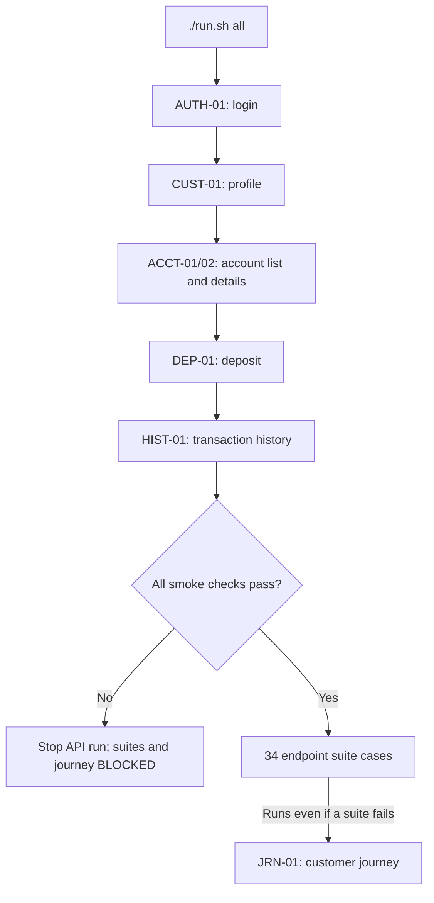
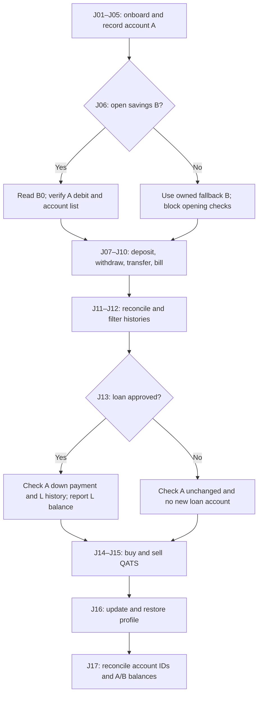
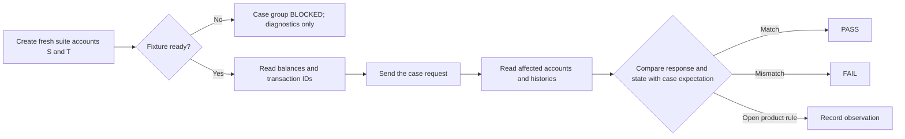
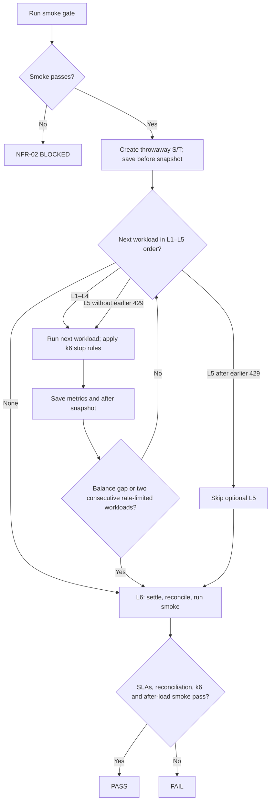

# ParaBank test case catalog

This document describes the action and expected result for every test in the [test design](../deliverables/STD.md). It is a test specification, not a record of current PASS/FAIL results; see the [run index](../results/index.md) for verdicts. Some design expectations are not yet asserted by the runner; those gaps are called out below.

| Section | Unique STD cases | Coverage |
|---|---:|---|
| Smoke | 6 | AUTH-01, CUST-01, ACCT-01, ACCT-02, DEP-01, HIST-01 |
| Journey | 1 | JRN-01, with setup J01 and API steps J02–J17 |
| Full test plan | 38 | Remaining functional cases, including four manual cases |
| Load | 2 | NFR-01 and NFR-02; L1–L6 are parts of NFR-02 |
| **Total** | **47** | Each STD case appears once in this catalog |

**Terms and test data.** `A` is an existing account owned by the configured test user. Endpoint suites create checking accounts `S` and `T` for their money cases. The journey opens savings account `B`; `L` is a loan account if the loan is approved. A *read-back* is a separate API request after a write. Balance comparisons use cents. For rejected money requests, compare the before and after balances and transaction IDs. Use only registered test users and accounts created by this project; TRF-09 uses a throwaway user because it can corrupt accounts.

**Expected-result basis.** `C#` denotes a documented API contract, `A#` a proposed business rule requiring product confirmation, and `O#` an observation used to interpret data. An **Open** expectation records behavior without declaring a product-rule PASS or FAIL. The exact status for some invalid requests remains open; a 4xx and unchanged state are the proposed safety expectations. Date-filter inputs use `MM-dd-yyyy`; transaction calendar dates are compared in UTC.

## Smoke

Run these six cases first. A failure stops the API run before the endpoint suites and journey. Smoke uses existing account `A`; DEP-01 deposits into `A` here, while the independent deposit suite uses `S`.

**API execution flow**

### AUTH-01 — Valid login (P1)

**Scenario:** A registered test user logs in with their own credentials.

| Step | Action | Expected result |
|---:|---|---|
| 1 | Send `GET /login/{username}/{password}` with the configured user's credentials. | HTTP 200 and a response matching the Customer schema (C1). |
| 2 | Compare the returned name, address, phone and SSN with the registration profile. | The identity and profile match the registered user (A7); retain the customer ID for later steps. |

### CUST-01 — View own profile (P1)

**Scenario:** The customer endpoint returns the same person as login.

| Step | Action | Expected result |
|---:|---|---|
| 1 | Send `GET /customers/{customerId}` using AUTH-01's ID. | HTTP 200 and a Customer-schema response (C1). |
| 2 | Compare every customer field with the AUTH-01 response. | Both responses describe the same customer (A7). |

### ACCT-01 — List own accounts (P1)

**Scenario:** The registered customer can list their accounts.

| Step | Action | Expected result |
|---:|---|---|
| 1 | Send `GET /customers/{customerId}/accounts`. | HTTP 200 and a list of Account-schema objects (C1); at least one account is available. |
| 2 | Check each account's `customerId` and select the default account `A`. | Every listed account belongs to the test customer (A6). |

### ACCT-02 — Account details match (P1)

**Scenario:** An account has the same details in the list and single-account response.

| Step | Action | Expected result |
|---:|---|---|
| 1 | Send `GET /accounts/{id}` for each account listed in ACCT-01. | HTTP 200 and an Account-schema response for every account (C1). |
| 2 | Compare each account's ID, type, balance and customer ID with its ACCT-01 list entry. | Values match exactly (A7). Select `A` for the later smoke steps. The browser cross-check compares accounts with the web UI separately. |

### DEP-01 — Valid deposit (P1)

**Scenario:** A small deposit adds exactly 10.00 to the smoke account.

| Step | Action | Expected result |
|---:|---|---|
| 1 | Record `A`'s balance and transaction IDs. | A readable baseline is available. |
| 2 | Send `POST /deposit?accountId={A}&amount=10`. | HTTP 200 with the observed deposit success text (O5). |
| 3 | Read `A` again. | Its balance has increased by exactly 10.00 (A2). HIST-01 checks the ledger entry. |

### HIST-01 — History shows a deposit (P1)

**Scenario:** The smoke deposit is visible in transaction history.

| Step | Action | Expected result |
|---:|---|---|
| 1 | Send `GET /accounts/{A}/transactions` after DEP-01. | HTTP 200 and a list of Transaction-schema objects (C1). |
| 2 | Compare transaction IDs with the baseline from before the deposit. | Exactly one new Credit transaction of 10.00 is present and dated today (A2). |

**Runner coverage:** The generated smoke collection reads only selected account `A` in ACCT-02. The design calls for comparing every account in the list.

## Journey

### JRN-01 — Customer lifecycle journey (P1)

**Scenario:** One customer moves through onboarding, account opening, money movement, statements, a loan, investing and a profile update, then reconciles the resulting state. Run after smoke. `A0` is the starting balance of `A`; `B0` is the **read-back balance** of `B`; `D0` is the opening debit from `A` (`B0` if `B` was created, otherwise zero). When `B` is newly opened, its opening amount is observed, not fixed at 100.00: saved runs have shown both 100.00 and 200.00. Expected balances are calculated from the values read in this run. If account opening fails, the runner uses an owned fallback account for `B` and blocks the opening checks. When another extended step cannot complete, mark dependent checks BLOCKED and leave its amount out of the final ledger.

**Journey flow**

| Step | Action | Expected result |
|---|---|---|
| J01 | Register or verify the project's test user through the web UI before the API journey. | The registration is confirmed and the user has an account. This is setup, not a separate STD case. |
| J02 | Log in with `GET /login/{username}/{password}`. | HTTP 200; Customer schema; profile equals registration data (C1, A7). Save `customerId`. |
| J03 | Read `GET /customers/{customerId}`. | Every field matches J02 (C1, A7). |
| J04 | List `GET /customers/{customerId}/accounts`. | HTTP 200; at least one account; every account belongs to this customer (C1, A6). Save `A`, `A0` and starting account IDs. |
| J05a | Read `GET /accounts/{A}`. | ID, type, balance and customer ID match J04's entry (A7). |
| J05b | Read `GET /accounts/{A}/transactions`. | HTTP 200 and Transaction-schema list (C1). Save existing transaction IDs as the baseline. |
| J06a | Open savings account `B` with `POST /createAccount` using `A` as source. | HTTP 200; Account schema; new account belongs to this customer and has type SAVINGS (C1). This is an extended endpoint. |
| J06b | Read `GET /accounts/{B}` and, if `B` was created, compare with the create response. | HTTP 200; save `B0`. For a newly created `B`, its create response balance should equal the read-back balance (A7); record the actual opening amount (O1). |
| J06c | Read `A` again. | `A = A0 − D0`: opening `B` conserved the funds moved from `A`; a fallback `B` leaves `A` unchanged (A1). |
| J06d | List customer accounts again. | The list contains the starting accounts plus newly created `B`, or just the starting set if opening failed, with no unexpected account (C1). |
| J07a | Deposit 200.00 into `B`. | HTTP 200 with deposit success text (C1, O5). |
| J07b | Read `B`. | `B = B0 + 200.00` (A2). |
| J08a | Withdraw 20.00 from `B`. | HTTP 200 with withdrawal success text (C1, O5). |
| J08b | Read `B`. | `B = B0 + 180.00` (A2). |
| J09a | Transfer 50.00 from `B` to `A`. | HTTP 200 with transfer success text (C1, O5). |
| J09b | Read `A` and `B`. | `A = A0 − D0 + 50.00`, `B = B0 + 130.00`; their combined balance is unchanged by the transfer (A1). |
| J10a | Pay 30.00 from `A` to the fully specified City Utilities payee. | HTTP 200; BillPayResult echoes the payee, amount and source account (C1, A7). |
| J10b | Read `A`. | `A = A0 − D0 + 20.00` (A2). |
| J11a | Read the full transaction list of `A`. | New rows, relative to J05b, are the `B0` opening debit if `B` was created, the 50.00 transfer credit and the 30.00 bill debit (C1, A2). Save the transfer credit ID. |
| J11b | Read the full transaction list of `B`. | It contains the `B0` opening credit if `B` was created, plus the 200.00 deposit credit, 20.00 withdrawal debit and 50.00 transfer debit from this journey (C1, A2). |
| J11c | Read the saved transfer transaction by ID. | Every field matches its J11a list entry (A7). This is an extended endpoint. |
| J12a | Filter `A`'s history by amount 50.00. | Result IDs equal the 50.00 rows of J11a's full list and include the transfer credit (C2). |
| J12b | Filter `A`'s history by today's date. | Result IDs equal the rows dated today in the full list, using their UTC calendar date (C2). |
| J12c | Filter `A`'s history from today through today. | Result IDs equal the same dated subset as J12b (C2). |
| J12d | Filter `A`'s history by current month and type Debit. | Result IDs equal that full-list subset and include the bill debit, plus the opening debit if `B` was created (C2). |
| J13a | Request a 500.00 loan with 50.00 down payment from `A`. | HTTP 200; LoanResponse schema, provider name, boolean `approved` and account ID if approved (C1). If denied, record the response message. The approval rule is Open. |
| J13b | List the customer's accounts. | If approved, the list contains one new owned loan account `L`; if denied, it is unchanged (A12). |
| J13c | Read `A`. | If approved, `A` decreased by 50.00; if denied, `A` is unchanged (A12). |
| J13d | If approved, read account `L`. | Record its type and balance. The observed 500.00 loan balance is report-only until the disbursement rule is confirmed (O4, Open). |
| J13e | Read `A`'s and, if approved, `L`'s transaction lists. | An approved loan has a 50.00 down-payment debit on `A` and a loan entry on `L` (A12). |
| J14a | Buy two QATS shares at 10.00 each from `A`. | HTTP 200; a QATS position with two shares is returned (C1). This is an extended endpoint. |
| J14b | List customer positions. | The new position ID appears with two shares (C1, A7). |
| J14c | Read that position by ID. | Shares = 2, purchase price = 10.00 and customer ID matches J02 (C1, A7). |
| J14d | Read `A`. | Its balance decreased by 20.00, the purchase price of the shares (A1). |
| J15a | Sell one QATS share at 12.00 into `A`. | HTTP 200 and a position response showing one remaining share (C1). |
| J15b | Read the position. | One share remains (A7). |
| J15c | Read `A`. | Its balance increased by 12.00 (A1). |
| J16a | Update the customer's street and phone using all required profile fields. | HTTP 200 with success text (C1). This is an extended endpoint. |
| J16b | Read the customer profile. | Street and phone changed; other fields are unchanged (A7). |
| J16c | Log in again. | Login still works and returns the updated profile (A7). |
| J16d | Restore the original profile, then read it. | Every field again matches the registration profile (A7); the test user remains reusable. |
| J17 | List accounts and read back each account. | Account IDs equal the starting set plus `B` if it was created and `L` if approved. `A` and `B` match the running expected-balance ledger; `L` is reported separately until the loan rule is clarified (A1, A2, A12). |

**Runner coverage:** The generated journey currently checks HTTP 200 but not the success text at J07a, J08a, J09a and J16a. J17 checks account IDs and balances from the account list without separate account read-backs. These remain design expectations to verify manually or add to the runner.

## Full test plan

These are the **38 remaining functional cases**. They use independent endpoint-suite fixtures where possible. The four cases marked *manual* run in Chrome; the other 34 run through the generated Postman collection. Smoke and journey cases are specified above and are not counted again here.

**Common endpoint-suite money-case flow**

### Authentication, customer and account access

#### AUTH-02 — Wrong password (P2)

**Scenario:** A registered user supplies an incorrect password.

| Step | Action | Expected result |
|---:|---|---|
| 1 | Send login with the user's real username and a deliberately wrong password. | No Customer data is returned (A9). Record status and body; the exact failure status is Open. |

#### AUTH-03 — Password sent in the URL (P2, manual)

**Scenario:** Inspect whether API login exposes a password in its request URL.

| Step | Action | Expected result |
|---:|---|---|
| 1 | Inspect the documented `GET /login/{username}/{password}` route. | The route's credential placement is recorded. |
| 2 | Send a login with a disposable wrong password and inspect the request URL. | A password should not travel in a URL (A6); if it appears in the path, record a design failure without exposing the real password. |

#### AUTH-04 — Unknown user (P2)

**Scenario:** Login must not reveal whether an account name exists.

| Step | Action | Expected result |
|---:|---|---|
| 1 | Save AUTH-02's wrong-password response. | A comparison baseline is available. |
| 2 | Log in with a nonexistent username. | No Customer data; status and body match AUTH-02 (A9). |

#### AUTH-05 — Injection in username (P3, manual)

**Scenario:** A username containing `' OR '1'='1` is submitted to login.

| Step | Action | Expected result |
|---:|---|---|
| 1 | Submit the injection string using only the project's test environment. | The application rejects it without customer data or a 5xx error (A8). If Cloudflare blocks the request first, mark the API test BLOCKED rather than PASS or FAIL. |

#### CUST-02 — Customer that does not exist (P2)

**Scenario:** Read an obviously nonexistent customer ID.

| Step | Action | Expected result |
|---:|---|---|
| 1 | Send `GET /customers/-1`. | Error and no Customer data (A8); record the status because the precise code is Open. |

#### CUST-03 — Profile without logging in (P1)

**Scenario:** Request this project's own customer profile without a session.

| Step | Action | Expected result |
|---:|---|---|
| 1 | Use a client with no login cookie or authorization header. | No authenticated identity is supplied. |
| 2 | Send `GET /customers/{ownCustomerId}`. | Rejected, proposed 401/403, with no profile or SSN disclosed (A6). |

#### ACCT-03 — Account that does not exist (P2)

**Scenario:** Read two obviously nonexistent account IDs.

| Step | Action | Expected result |
|---:|---|---|
| 1 | Send `GET /accounts/-1`. | Error with no Account data (A8); exact status is Open. |
| 2 | Send `GET /accounts/0`. | The same safety condition holds (A8). |

#### ACCT-04 — Account without logging in (P1)

**Scenario:** Request an owned account without a session.

| Step | Action | Expected result |
|---:|---|---|
| 1 | Use a client with no login cookie or authorization header. | No authenticated identity is supplied. |
| 2 | Send `GET /accounts/{ownAccountId}`. | Rejected, proposed 401/403, with no balance or account data (A6). |

#### ACCT-05 — Account ID that is not a number (P3)

**Scenario:** The account path receives a nonnumeric ID.

| Step | Action | Expected result |
|---:|---|---|
| 1 | Send `GET /accounts/abc`. | A clear 4xx error, no account data and no server error (A8). |

### Transfers

#### TRF-01 — Valid transfer (P1)

**Scenario:** Move 1.00 between two owned accounts.

| Step | Action | Expected result |
|---:|---|---|
| 1 | Record balances and transaction IDs for `S` and `T`. | A before-state baseline is available. |
| 2 | Send `POST /transfer` for 1.00 from `S` to `T`. | HTTP 200 with the transfer success text (O5). |
| 3 | Read both accounts and histories. | `S − 1.00`, `T + 1.00`, total conserved; one matching Debit on `S` and Credit on `T` (A1, A2). |

#### TRF-02 — More than the balance (P1)

**Scenario:** A transfer amount exceeds the source balance.

| Step | Action | Expected result |
|---:|---|---|
| 1 | Record `S` and `T` balances and transaction IDs. | Baseline available. |
| 2 | Transfer `S`'s balance plus 1000.00 to `T`. | Request rejected (A4). |
| 3 | Read back both accounts and histories. | Neither balance nor ledger changed (A4). |

#### TRF-03 — Negative amount (P1)

**Scenario:** A transfer attempts to move −1.00.

| Step | Action | Expected result |
|---:|---|---|
| 1 | Record `S` and `T` balances and transaction IDs. | Baseline available. |
| 2 | Transfer −1.00 from `S` to `T`. | Request rejected (A3). |
| 3 | Read back both accounts and histories. | Neither balance nor ledger changed (A3). |

#### TRF-04 — Zero amount (P2)

**Scenario:** A transfer attempts to move 0.00.

| Step | Action | Expected result |
|---:|---|---|
| 1 | Record `S` and `T` balances and transaction IDs. | Baseline available. |
| 2 | Transfer 0.00 from `S` to `T`. | Request rejected (A3). |
| 3 | Read back both accounts and histories. | Balances unchanged; no zero-value transaction created (A3). |

#### TRF-05 — Same account (P2)

**Scenario:** A transfer uses `S` as both source and target.

| Step | Action | Expected result |
|---:|---|---|
| 1 | Record `S`'s balance and transaction IDs. | Baseline available. |
| 2 | Transfer 1.00 from `S` to `S`. | Request rejected (A10). |
| 3 | Read back `S`. | Balance and ledger unchanged (A10). |

#### TRF-06 — Account that does not exist (P2)

**Scenario:** Transfer 1.00 to target account `-1`.

| Step | Action | Expected result |
|---:|---|---|
| 1 | Record `S`'s balance and transaction IDs. | Baseline available. |
| 2 | Transfer 1.00 from `S` to `-1`. | Error without a server failure (A8); exact status is Open. |
| 3 | Read back `S`. | Balance and ledger unchanged (A8). |

#### TRF-07 — Missing amount (P2)

**Scenario:** The required transfer amount is omitted.

| Step | Action | Expected result |
|---:|---|---|
| 1 | Record `S` and `T` balances and transaction IDs. | Baseline available. |
| 2 | Send `POST /transfer` without `amount`. | A 4xx validation error, not a 5xx (C1, A8). |
| 3 | Read back both accounts. | Balances and ledgers unchanged (A8). |

#### TRF-08 — Same transfer sent twice (P3, manual)

**Scenario:** Determine how the system handles two identical submitted transfers.

| Step | Action | Expected result |
|---:|---|---|
| 1 | Record both owned accounts' balances and activity. | Baseline available. |
| 2 | Submit the same 1.00 transfer twice through the web UI. | Record both responses and whether a duplicate warning appears. |
| 3 | Read the balances and activity again. | Record whether one or two transfers were booked. Duplicate policy is Open, so the observation alone has no fixed PASS/FAIL verdict. |

#### TRF-09 — Amount below one cent (P1, manual)

**Scenario:** A sub-cent transfer is tried only on a throwaway customer's accounts.

| Step | Action | Expected result |
|---:|---|---|
| 1 | Register a throwaway customer, open two owned accounts and record both balances. | Healthy, readable baseline; regular test users are not touched. |
| 2 | Transfer 0.01 as a control, then transfer 0.005 between the same accounts. | The 0.005 input is rejected or rounded to a valid cent amount (A5). |
| 3 | Read both accounts, the account list and the web UI. | All remain readable and financially consistent, with no sub-cent corruption or 5xx (A5, A8). |

#### TRF-10 — Exact balance (P2)

**Scenario:** The source sends its full available balance.

| Step | Action | Expected result |
|---:|---|---|
| 1 | Read `S` and `T` balances. | `S`'s exact transferable amount is known. |
| 2 | Transfer that amount from `S` to `T`. | HTTP 200 (A1, A4). |
| 3 | Read back both accounts. | `S = 0`; `T` increased by the same amount and the combined balance is unchanged (A1, A4). |

### Deposits, withdrawals and bill payments

#### DEP-02 — Zero deposit (P2)

**Scenario:** A deposit amount of 0.00 is submitted.

| Step | Action | Expected result |
|---:|---|---|
| 1 | Record `S`'s balance and transaction IDs. | Baseline available. |
| 2 | Deposit 0.00 into `S`. | Request rejected (A3). |
| 3 | Read back `S`. | Balance unchanged and no zero-value transaction (A3). |

#### DEP-03 — Negative deposit (P1)

**Scenario:** A deposit amount of −5.00 is submitted.

| Step | Action | Expected result |
|---:|---|---|
| 1 | Record `S`'s balance and transaction IDs. | Baseline available. |
| 2 | Deposit −5.00 into `S`. | Request rejected (A3). |
| 3 | Read back `S`. | Balance and ledger unchanged (A3). |

#### WDR-01 — Valid withdrawal (P1)

**Scenario:** Withdraw 5.00 from an owned account.

| Step | Action | Expected result |
|---:|---|---|
| 1 | Record `S`'s balance and transaction IDs. | Baseline available. |
| 2 | Withdraw 5.00 from `S`. | HTTP 200 with the withdrawal success text (O5). |
| 3 | Read back `S` and its history. | Balance decreased by 5.00 and exactly one matching Debit was added (A2). |

#### WDR-02 — More than the balance (P1)

**Scenario:** Withdraw more than the account holds.

| Step | Action | Expected result |
|---:|---|---|
| 1 | Record `S`'s balance and transaction IDs. | Baseline available. |
| 2 | Withdraw `S`'s balance plus 1000.00. | Request rejected (A4). |
| 3 | Read back `S`. | Balance and ledger unchanged (A4). |

#### WDR-03 — Negative withdrawal (P1)

**Scenario:** Withdraw −5.00.

| Step | Action | Expected result |
|---:|---|---|
| 1 | Record `S`'s balance and transaction IDs. | Baseline available. |
| 2 | Withdraw −5.00. | Request rejected (A3). |
| 3 | Read back `S`. | Balance and ledger unchanged (A3). |

#### WDR-04 — Zero withdrawal (P2)

**Scenario:** Withdraw 0.00.

| Step | Action | Expected result |
|---:|---|---|
| 1 | Record `S`'s balance and transaction IDs. | Baseline available. |
| 2 | Withdraw 0.00. | Request rejected (A3). |
| 3 | Read back `S`. | Balance unchanged and no zero-value transaction (A3). |

#### BILL-01 — Valid bill payment (P1)

**Scenario:** Pay 5.00 to City Utilities with complete payee details.

| Step | Action | Expected result |
|---:|---|---|
| 1 | Record `S`'s balance and transaction IDs. | Baseline available. |
| 2 | Send `POST /billpay` with amount 5.00 and the complete payee. | HTTP 200 and BillPayResult echoing payee, amount and source account (C1, A7). |
| 3 | Read back `S` and its history. | Balance decreased by 5.00 and exactly one bill Debit was added (A2). |

#### BILL-02 — More than the balance (P2)

**Scenario:** A bill exceeds the source balance.

| Step | Action | Expected result |
|---:|---|---|
| 1 | Record `S`'s balance and transaction IDs. | Baseline available. |
| 2 | Pay `S`'s balance plus 1000.00. | Request rejected (A4). |
| 3 | Read back `S`. | Balance and ledger unchanged (A4). |

#### BILL-03 — No payee details (P2)

**Scenario:** Bill pay receives an empty `{}` payee.

| Step | Action | Expected result |
|---:|---|---|
| 1 | Record `S`'s balance and transaction IDs. | Baseline available. |
| 2 | Send bill pay for 1.00 with an empty payee. | Rejected without a server error (A11); exact status is Open. |
| 3 | Read back `S`. | No debit and no ledger change (A11). |

#### BILL-04 — Negative bill (P1)

**Scenario:** Bill pay receives −5.00.

| Step | Action | Expected result |
|---:|---|---|
| 1 | Record `S`'s balance and transaction IDs. | Baseline available. |
| 2 | Send bill pay with amount −5.00. | Request rejected (A3). |
| 3 | Read back `S`. | Balance and ledger unchanged (A3). |

### Loans and transaction history

#### LOAN-01 — Loan result matches the accounts (P1)

**Scenario:** Loan response, source account and histories agree for a 500.00 request with 50.00 down payment.

| Step | Action | Expected result |
|---:|---|---|
| 1 | Record `S` balance, account IDs and transaction IDs. | Baseline available; `S` has at least 100.00. |
| 2 | Request the loan from `S`. | LoanResponse schema with provider name and boolean `approved`; an account ID if approved (C1). Approval policy is Open. |
| 3 | Read accounts, `S` and histories. | If approved: one new loan account, `S − 50.00`, a down-payment Debit and a loan entry (A12). If denied: no money or account changes. Record the loan account's observed balance without judging disbursement policy. |

#### LOAN-02 — Negative loan (P2)

**Scenario:** Request a loan amount of −100.00 with a 10.00 down payment.

| Step | Action | Expected result |
|---:|---|---|
| 1 | Record `S` balance, account IDs and transaction IDs. | Baseline available. |
| 2 | Submit the negative loan request. | Rejected or denied (A3). |
| 3 | Read back account list and `S`. | No loan account, source-balance change or new transaction (A3). |

#### LOAN-03 — Down payment larger than the loan (P2)

**Scenario:** Request 10.00 with a 20.00 down payment.

| Step | Action | Expected result |
|---:|---|---|
| 1 | Record `S` balance, transaction IDs and account IDs. | Baseline available for the observed effect. |
| 2 | Submit the request and record status, approval decision and message. | No unhandled 5xx; the acceptance rule is Open. |
| 3 | Read `S`, its history and the account list. | Preserve the observed effect for the product-rule question; do not assign a domain PASS/FAIL before clarification. |

#### LOAN-04 — Down payment larger than the balance (P2)

**Scenario:** Isolate insufficient source funds without also exceeding the loan amount.

| Step | Action | Expected result |
|---:|---|---|
| 1 | Record `S` balance, transaction IDs and account IDs. | Baseline available. |
| 2 | Set down payment to `S + 10.00` and loan amount to the down payment plus 100.00; submit the request. | Loan denied because the down payment exceeds available funds (A4). |
| 3 | Read `S`, its history and the account list. | No balance change, new transaction or loan account (A4). |

#### HIST-02 — Filter by amount (P2)

**Scenario:** Amount filtering returns exactly the matching history rows.

| Step | Action | Expected result |
|---:|---|---|
| 1 | Read the full `S` transaction list after a 10.00 deposit. | Save the row IDs and amounts as the oracle. |
| 2 | Request `/accounts/{S}/transactions/amount/10`. | Exactly the full-list rows with amount 10.00, with the same IDs and no omissions or extras (C2). |

#### HIST-03 — Filter by date (P2)

**Scenario:** Two date filter forms agree with the unfiltered list.

| Step | Action | Expected result |
|---:|---|---|
| 1 | Read the full `S` transaction list and compute each row's UTC date. | Save the rows dated today. |
| 2 | Request the `onDate/{today}` filter. | Exactly those rows, with the same IDs (C2). |
| 3 | Request `fromDate/{today}/toDate/{today}`. | The same dated subset as step 2 (C2). |

#### HIST-04 — Filter by month and type (P2)

**Scenario:** Valid month/type combinations select the correct rows; an invalid type is rejected.

| Step | Action | Expected result |
|---:|---|---|
| 1 | Read the full `S` history after deposit and withdrawal. | Save month and type for every row. |
| 2 | Filter the current month by `Credit`, `Debit`, `All`, and the numeric-month `All` variant. | Each result equals its matching full-list subset (`All` includes both types) (C2). |
| 3 | Filter with invalid type `CREDIT`. | Clear 4xx rejection rather than HTTP 500 (A8). |

#### HIST-05 — Wrong date format (P3)

**Scenario:** Date filters receive unsupported input.

| Step | Action | Expected result |
|---:|---|---|
| 1 | Request `onDate/2026-11-23` (ISO form). | Clear 4xx validation error, not a silent empty list (A8). |
| 2 | Request `onDate/not-a-date`. | Clear 4xx error with a useful message, not a server error (A8). |

#### HIST-06 — One transaction by ID (P3)

**Scenario:** A direct transaction read agrees with the account's history.

| Step | Action | Expected result |
|---:|---|---|
| 1 | Select a transaction ID from `S`'s full transaction list. | The comparison row is known. |
| 2 | Send `GET /transactions/{transactionId}`. | Every field matches the selected list row (A7). |

### Supporting executions

These executions check or reproduce cases above; they do **not** add to the 47 unique STD case IDs.

#### Browser cross-check (`./run.sh ui`)

**Scenario:** Confirm that the web UI and API agree after an API journey and transfer suite.

| Step | Action | Expected result |
|---:|---|---|
| 1 | Open Accounts Overview for the test user and read the same customer's account list through the API. | The same account IDs and balances appear in both views. |
| 2 | Open each recorded account's Activity page and read its details and transaction list through the API. | Account type, balance and transaction rows match by ID, type and amount. |
| 3 | Locate the journey transfer, bill, loan and suite transfer rows. | The expected movement is visible in the UI; record any discrepancy under its existing case ID. |

#### Coded tests (`./run.sh auto`)

**Scenario:** Recheck selected API cases using independent pytest and requests code.

| Step | Action | Expected result |
|---:|---|---|
| 1 | Run `test_customer_journey` (JRN-01). | The journey's account and balance checks hold; known defects remain visible as expected failures. |
| 2 | Run `test_transfer_conserves_total` (TRF-01) and `test_negative_transfer_rejected` (TRF-03). | The positive transfer conserves money; the negative transfer is rejected without state change. |
| 3 | Run `test_deposit_increases_balance` (DEP-01) and both `test_unknown_account_returns_error` parameters (ACCT-03). | Deposit adds the requested amount; account IDs `-1` and `0` return errors without account data. |

#### Defect reproduction (`./run.sh repro`)

**Scenario:** Repeat documented failures on fresh throwaway users to preserve evidence.

| Step | Action | Expected result |
|---:|---|---|
| 1 | Run each documented failing input beside a working control input. | The control establishes a readable baseline and the target request produces a captured response. |
| 2 | Read affected state after each request and compare with the linked bug report. | Request, response and before/after evidence show whether the bug still reproduces; no new STD case ID is counted. |

**Runner coverage:** The expected results above and in the case tables describe the test design. The current manual TRF-08 run captures balances and post-run activity but no pre-run transaction IDs; TRF-09 checks for readable accounts after a sub-cent request without a full balance/ledger comparison. The generated collection also leaves some checks narrower than the design: CUST-03, ACCT-04 and ACCT-05 check selected sensitive fields or status; HIST-05 does not assert a useful message; LOAN-01's denial branch does not check an unchanged source ledger; LOAN-03 does not read transaction history. These checks require manual review or runner additions before claiming full automated coverage.

## Load

### NFR-01 — Response times in functional runs (P3)

**Scenario:** Check timing of the functional API requests already made. This is not a separate k6 workload.

| Step | Action | Expected result |
|---:|---|---|
| 1 | Record client-side duration and response status for every functional request; group by endpoint. | No request times out beyond 5 seconds. |
| 2 | For each endpoint, calculate p95 and compare with the read target of 1000 ms or write target of 1500 ms. | An endpoint with at least 20 requests fails NFR-01 if its p95 exceeds its target; otherwise label p95 informational. List responses above the target as outliers. |

### NFR-02 — Small load and financial reconciliation (P2)

**Scenario:** Compare baseline and higher load for account reads and transfers, then confirm money and transaction counts still reconcile. Run only after a passing smoke gate. Use a fresh throwaway customer, checking accounts `S` and `T`, and deposit 500.00 into `S`; record both starting balances and transaction counts. All requests have a 5-second timeout. Target p95 is **≤ 1000 ms for reads** and **≤ 1500 ms for transfers**, with **< 1% HTTP/body-check errors** per endpoint or scenario. A p95 verdict needs at least 20 completed requests. Approximately two minutes separates workloads to respect the shared site's rate limit. Request counts below describe the workload, not a required exact count.

**Load session flow**

#### L1 — Read baseline

**Scenario:** Establish current account-read latency at a low rate.

| Step | Action | Expected result |
|---:|---|---|
| 1 | One virtual user reads `GET /accounts/{S}` every 1.5 seconds for 90 seconds. | Each response is 200 JSON with ID `S`, numeric balance and type CHECKING. |
| 2 | Calculate latency and error rate for the completed reads. | p95 ≤ 1000 ms, errors < 1%, no HTTP 429; save the baseline for L2 and L5. |

#### L2 — Higher read load

**Scenario:** Increase account-read arrival rate in four steps while retaining the L1 response checks.

| Step | Action | Expected result |
|---:|---|---|
| 1 | Read `S` at arrival rates 0.67, 1, 1.5 and 2 requests/second, about 45 seconds per step, at most 10 virtual users. | Each completed read meets L1's response checks. |
| 2 | Calculate p95 and errors for each completed step and compare p95 with L1. | p95 ≤ 1000 ms and errors < 1% for judged steps. Report growth against L1 as diagnostic evidence. Record a 429 as rate limiting, stop the scenario and report completed-step metrics separately. |

#### L3 — Transfer baseline

**Scenario:** Establish current transfer latency with sequential one-unit writes.

| Step | Action | Expected result |
|---:|---|---|
| 1 | One virtual user transfers 1.00 from `S` to `T` every 2 seconds for 60 seconds. | Each confirmed response is HTTP 200 with the exact transfer success text; count confirmed and uncertain transfers separately. |
| 2 | Calculate write latency and errors. | p95 ≤ 1500 ms and errors < 1%; retain the confirmed count for L6 and the p95 baseline for L4. |

#### L4 — Concurrent transfers

**Scenario:** Submit bursts of simultaneous transfers against the same two accounts.

| Step | Action | Expected result |
|---:|---|---|
| 1 | Send five simultaneous 1.00 transfers from `S` to `T` every 7.5 seconds for 16 rounds. | Each confirmed response meets the L3 status and body checks; average traffic stays low while the same two accounts receive concurrent writes. |
| 2 | Calculate p95 and errors; snapshot balances and transaction counts. | p95 ≤ 1500 ms, errors < 1%; compare latency with L3. The immediate check confirms `S + T` stays constant; stop before later scenarios if it fails. L6 checks exact account and ledger deltas. |

#### L5 — Reads during writes (optional)

**Scenario:** Read the source account while transfers debit it.

| Step | Action | Expected result |
|---:|---|---|
| 1 | If earlier scenarios did not hit a stop condition, read `S` at 1 request/second total and transfer 1.00 from `S` to `T` at 1 request/3 seconds total for 120 seconds. | Each request meets its L1 or L3 response checks; balances read for `S` never increase while only debits are occurring. |
| 2 | Calculate separate read and transfer metrics, and snapshot balances and transaction counts. | Read p95 ≤ 1000 ms, write p95 ≤ 1500 ms, errors < 1% for each endpoint; compare read p95 with L1 as a diagnostic. The immediate check confirms `S + T` stays constant; L6 checks exact account and ledger deltas. |

#### L6 — After-load checks

**Scenario:** Reconcile money and ledger entries after load, then confirm the smoke gate still passes.

| Step | Action | Expected result |
|---:|---|---|
| 1 | After a short settle period, read `S`, `T` and both transaction lists. | Accounts and histories remain readable. |
| 2 | Compare the before and after snapshots with the number of confirmed transfers from L3–L5. | `S` decreased and `T` increased by the confirmed total (allow only correctly bounded uncertain outcomes); `S + T` is unchanged; each side has one new transaction per completed transfer. |
| 3 | Run the smoke gate again. | Smoke passes and the shared site remains usable. The load session passes only if the scenario SLAs, reconciliation, k6 execution and after-load smoke all pass. |

**Stop conditions:** Any HTTP 429 stops its scenario; repeated rate limiting stops the session. Abort a scenario if errors exceed 10% after the initial sample or p95 exceeds 5 seconds. Stop later workloads after a known financial-integrity mismatch or failed smoke. No admin endpoints or other customers' accounts are used.
