# ParaBank Banking API — QA Exercise Execution Plan

**Source:** `docs/exercise/01_Exercise_Instructions.md` (contract: ParaBank OpenAPI)
**System under test:** ParaBank REST API — `https://parabank.parasoft.com/parabank/services/bank`
**Goal:** Decide, with evidence, whether the API is ready for release, and deliver the six artifacts the exercise asks for.

## Execution status (updated 2026-11-24)

| Stage | Status | Commit | Output | Result |
|---|---|---|---|---|
| 0 Setup | ✅ Done | `ccef039` | `tests/scripts/setup-users.mjs` (`./run.sh setup`), `.env`, `tests/postman/ParaBank_QA.postman_environment.json` | Two users (`PARABANK`, `PARABANK2`) registered or verified; IDs written to `.env`. Re-run after every site reset |
| 1 Exploration | ✅ Done | `a68f27c` | `Business_Rules.md`, `evidence/exploration/` | Every in-scope endpoint probed; rules labelled Contract C#, Rule A#, Observed O#; latency baseline measured; sub-cent transfer defect found (E1) |
| 2 Test design | ✅ Done | `a68f27c` | `STD.md` | 47 cases: smoke gate (6), suites 11–19, journey JRN-01 (J02–J17); SLA model (read p95 ≤ 1000 ms, write p95 ≤ 1500 ms) |
| 3 Postman build and execution | ✅ Done | `457d6db`, `fc94862` | `tests/postman/`, `results/kept/2026-11-23T16-04-00Z-api`, `*-ui`, `*-manual` | API: 19 PASS · 21 FAIL · 1 NEEDS-CLARIFICATION · 5 run outside Postman (4 manual, NFR-02 in Stage 5). Repeat run `2026-11-23T17-20-52Z-api`: identical verdicts. UI cross-check: 24 MATCH, 1 RULE NOT MET (A12). Manual: 2 FAIL, 1 BLOCKED (firewall), 1 NEEDS-CLARIFICATION |
| 4 Isolation and bug reports | ✅ Done | `1828de4` | `Bug_Reports.md`, `evidence/bugs/` (BUG-001 … BUG-016, S-LOAN) | 15 defects from Stage 3: 3 Critical, 5 High, 7 Medium (BUG-016 added in Stage 5: 4 Critical in total). Every failure isolated and reproduced on fresh throwaway users, with a passing control input. Re-reproduced 2026-11-23 (`./run.sh repro`): all 15 still fail |
| 5 Load and performance | ✅ Done | — | `tests/load/` (plan, k6 scripts, runner), `results/kept/2026-11-24T07-44-12Z-load`, isolation `results/kept/2026-11-24T08-03-30Z-load` | Speed: every SLA met (read p95 320 → 415 ms at 0.68 → 2 req/s; transfer p95 436 → 574 ms with 5 at once), 0 errors, 0 × 429. **Correctness FAIL:** concurrent transfers lost debits (money created): 32.00 in run 1, 16.00 in re-run `results/kept/2026-11-24T08-22-10Z-load`, and per-test balances place all of it in L4 (5 at once). Sequential L3 and L5 reconcile → **BUG-016 (Critical)**, isolated on a fresh customer. NFR-02 = FAIL |
| 6 Test summary report | ✅ Done | — | `STR.md`, `STR.pdf`, generator `tests/scripts/build-str.mjs` | **NO-GO**: 4 Critical defects open (BUG-001, BUG-002, BUG-003, BUG-016). Generated from the latest complete runs of each kind, so every cycle gets its own report (`./run.sh report`, or automatically at the end of `./run.sh cycle`) |
| 7 Optional automation | ◐ Partly covered | — | `run.sh` | One-command runs exist for every layer; coded tests (pytest/Newman) not written |
| 8 Packaging | ⬜ Not started | — | the repository | Credential scan and forbidden-endpoint guard already run on every change |

### Changes made during execution (vs. the original plan)

| Area | Original plan | What was done | Why |
|---|---|---|---|
| Runner | Postman CLI or Newman, run by hand | Postman CLI 1.93 through `./run.sh` (`tests/scripts/run-api.mjs`); credentials passed with `--env-var` | One command per layer, nothing secret in files |
| Collection source | Built in Postman from the OpenAPI | Generated by `tests/scripts/build-collection.mjs` from the STD (152 requests); rebuilt before every run | Reviewable in Git, test IDs match the STD exactly |
| Schema checks | tv4 | ajv in the Postman sandbox | tv4 is deprecated |
| Pacing | Sequential | 1.5 s between requests, 5 s timeout, abort on HTTP 429 | Cloudflare rate-limits the public site |
| Suite fixtures | One shared fixture folder | Each suite opens its own S/T accounts and deposits them back to 0 afterwards (`cleanup`) | Overdraft suites made the customer total negative, which denied later loans |
| Extended folder `20 EXT` | Separate OPN / INV / PRF suites | Covered inside the journey (J06, J14–J16) | Extended scope; journey already checks them |
| Results | Run reports + a results table filled by hand | `summarize.mjs` writes `summary.md` / `results.json` per run (verdict per case + NFR-01 table) | Repeatable verdicts |
| Web UI cross-check | Manual | Playwright on local Chrome (`./run.sh ui`), compares every page with the API | Evidence with screenshots, repeatable |
| Manual cases | Manual | `./run.sh manual`: visible browser, captioned screenshots, API evidence cards; TRF-09 only on a throwaway user | Destructive case must not break the test users |
| Bug reproduction | Re-run the failing case | `./run.sh repro`: two fresh throwaway users per run, control input next to each failing input, balances before/after | Proves each defect on clean data |
| Repo layout | `evidence/<defect-id>/`, outputs per stage | Run folders `results/runs/<UTC>-<kind>/` (local) and `results/kept/` (committed); `results/index.md` + `history.md`; frozen evidence in `evidence/`; scripts in `tests/scripts/`; exercise files in `docs/exercise/` | Tests must run many times; see *Running the tests repeatedly* |
| Exercise files | In the root | `docs/exercise/` | Deliverables stay in the root |

### Open items
- Load test: deposit, withdraw and bill pay were not load-tested for the BUG-016 race.
- STD §5.9 E-table is not yet cross-referenced to the BUG IDs; rule A11 still says "UI cross-check pending".
- AUTH-05 (injection) is BLOCKED by the site firewall: re-test on a local ParaBank instance if one is available.
- Spec questions S6 (duplicate transfers), S7 (loan approval uses total balance) and S8 (loan denial reason) are waiting for R&D.

### Test architecture: three layers

| Layer | What it is | Purpose | When it runs |
|---|---|---|---|
| **1. Smoke** | 6 short, stable checks on in-scope endpoints only: login, profile, account list, account details, one small deposit and its transaction (STD §5.8). | **Gate**: proves the user, the site and the money path work before anything else runs. | First, every session and before load tests. Fail → stop, everything BLOCKED |
| **2. Endpoint test suites** | One suite per endpoint with its own fresh fixtures: positive, negative, boundary, security and data-integrity cases. | **Depth and isolation**: which endpoint is at fault and under which inputs; logs and evidence. | After smoke. Suites are independent of each other and of the journey |
| **3. Customer journey (JRN-01)** | One end-to-end scenario simulating a real customer's lifecycle — onboarding, opening an account, managing money, paying bills, applying for a loan, investing, updating the profile. Every step verifies the data produced by the previous steps. | **Integration**: finds problems that only appear when operations are combined. | After smoke; non-blocking. A failing step is compared with its mapped suite |

The journey is deliberately **not** the smoke test: it is long, depends on extended endpoints and chains data, so one early failure would hide the health of everything else.

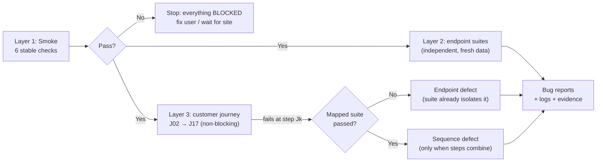

---

## 1. Ground rules (apply to every stage)

| # | Rule | How it is enforced |
|---|---|---|
| G1 | Shared public system; data is reset periodically | Journey and suites create their own data each run; nothing is reused across days |
| G2 | Never call `/cleanDB`, `/initializeDB`, `/setParameter`, `/startupJmsListener`, `/shutdownJmsListener` | Not present in any collection/script; collection pre-request guard rejects these URLs; grep check before submission |
| G3 | Load tests small and short | ≤ 20 VUs (plan uses ≤ 10), runs ≤ 2 min, paced requests |
| G4 | No testing of other people's users or accounts | Only IDs created by own runs; invalid IDs limited to obviously non-existent values (`-1`, `0`) |
| G5 | Public site down | Run ParaBank locally (Docker image / WAR) and state it in the STR |
| G6 | Credentials | Login puts the password in the URL path: throwaway password, redacted in exports, logs and evidence |

### Endpoint scope

| Endpoint | Instructions scope | Journey step | Endpoint suite |
|---|---|---|---|
| `GET /login/{username}/{password}` | In scope | J02, J16 | LOG |
| `GET /customers/{customerId}` | In scope | J03, J16 | CUS |
| `GET /customers/{customerId}/accounts` | In scope | J04, J06, J13, J17 | ACC |
| `GET /accounts/{accountId}` | In scope | after every money step | ACC |
| `GET /accounts/{accountId}/transactions` + filters | In scope | J11, J12 | TRX |
| `POST /transfer` | In scope | J09 | TRF |
| `POST /deposit` | In scope | J07 | DEP |
| `POST /withdraw` | In scope | J08 | WDR |
| `POST /billpay` | In scope | J10 | BIL |
| `POST /requestLoan` | In scope | J13 | LON |
| `POST /createAccount` | **Extended** | J06 | OPN |
| `GET /transactions/{transactionId}` | **Extended** | J11 | TRX |
| `buyPosition`, `sellPosition`, `GET /customers/{id}/positions`, `GET /positions/{id}` | **Extended** | J14, J15 | INV |
| `POST /customers/update/{customerId}` | **Extended** | J16 | PRF |

Extended endpoints are included because the journey needs them. Their defects are reported but tagged *extended scope*; the STR keeps the release recommendation for the in-scope API separate. Extended suites are kept small (P2/P3 except their positive case).

**Tools:** Postman (collection + environment), Postman CLI or Newman (command-line runs and JSON reports), k6 (load), Markdown (documents), web UI (registration and cross-checks).

---

## 2. Stage overview

| Stage | Name | Output | Exit gate |
|---|---|---|---|
| 0 | Setup | Registered user, environment file | API login returns own customer |
| 1 | Exploration and business rules | Business-rules ledger, spec questions | Every endpoint called once; rules written down |
| 2 | Test design (STD): journey + endpoint suites | `STD.md` | Journey specified; each in-scope endpoint has a suite; ≥ 25 cases; all 5 types covered |
| 3 | Postman: build and execute both layers | Collection + environment exports, run reports | Journey run; all P1 suite cases run; ≥ 12 cases executed |
| 4 | Failure isolation, log collection, bug reports | `Bug_Reports.md`, evidence bundles, spec ambiguities | Every failure isolated to an endpoint + input and documented |
| 5 | Load and performance | k6 scripts, results, analysis | Baseline + higher run for both endpoints |
| 6 | Test Summary Report (STR) | `STR.md` (1–2 pages) | Go / no-go with justification |
| 7 | Optional automation (bonus) | Coded journey + suite tests + README | Runs with one command |
| 8 | Packaging and submission | One folder / email | Deliverables checklist complete |

Current status: see *Execution status* at the top. Order: 0 → 1 → 2 → 3 sequential. Stage 4 runs alongside Stage 3 (triggered by failures). Stage 5 only after the smoke suite and the TRF-01 / ACCT-02 cases pass. Stage 7 only after Stages 0–6.

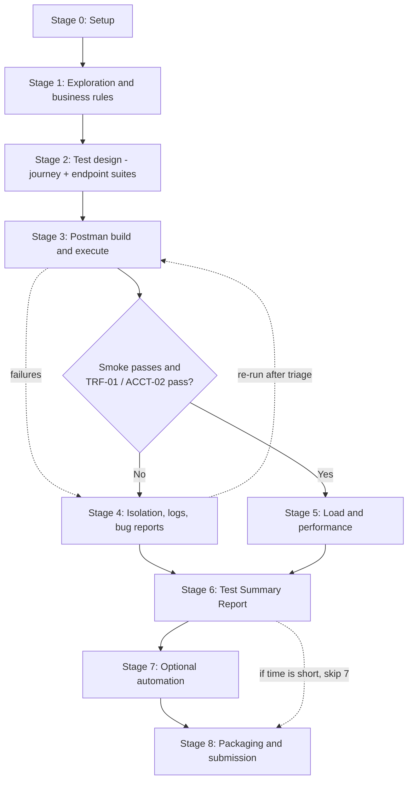

---

## Running the tests repeatedly

Every test run goes through one command, and every run gets its own folder. Details are in `README.md`.

| Command | What it runs | Stage |
|---|---|---|
| `./run.sh setup` | Register or verify the `.env` test users | 0 |
| `./run.sh smoke` · `suites` · `journey` · `all` | Postman collection via the Postman CLI | 3 |
| `./run.sh ui [apiRunId]` | Web UI cross-check of an API run | 3 |
| `./run.sh manual [cases]` | Manual cases in a visible browser, with screenshots | 3 |
| `./run.sh repro [--publish]` | Reproduce every known defect on fresh throwaway users | 4 |
| `./run.sh load [--dry]` | k6 load session L1–L6 | 5 |
| `./run.sh report [--kept] [--publish]` | Test Summary Report (STR.md + STR.pdf) from the latest runs | 6 |
| `./run.sh cycle [--keep]` | Whole cycle: all → ui → manual → load → report | 3–6 |
| `./run.sh keep <runId>` · `list` · `latest` | Results housekeeping | — |

**Run folders:**
- Every run writes `results/runs/<UTC time>-<kind>/` (kind = `api`, `ui`, `manual`, `repro`).
- Each folder holds `summary.md`, `results.json`, `run.json`, `logs/`, `reports/` and `screenshots/`.
- Run folders are git-ignored until kept: `--keep` or `./run.sh keep <runId>` moves the run to `results/kept/`, which is committed.

**Index and history:**
- `results/index.md` lists every run.
- `results/history.md` shows each case's verdict across the last 10 API runs and flags verdicts that changed.

**Frozen evidence:** `evidence/` holds the evidence cited by the documents: `exploration/` from Stage 1 and `bugs/` from Stage 4. Runs never overwrite it; only `./run.sh repro --publish` refreshes the bug bundles.

## Stage 0 — Setup

**Status:** ✅ Done (`ccef039`). Automated by `./run.sh setup`: registers the user through the web form only if API login fails, checks the profile, opens the fallback account and writes the IDs to `.env`.

1. Register a new user in the web UI (unique username, throwaway password, fake personal data). This is journey step **J01** — the API has no registration endpoint.
2. Log in to the web UI once; note the default account the system created.
3. Through the web UI, open one extra checking account as a **fallback fixture** for the endpoint suites (used if `/createAccount` itself is broken).
4. Create the Postman environment:

   | Variable | Value |
   |---|---|
   | `baseUrl` | `https://parabank.parasoft.com/parabank/services/bank` |
   | `username` / `password` | own credentials (secret, blanked before export) |
   | `firstName`, `lastName`, `street`, `city`, `state`, `zipCode`, `phoneNumber`, `ssn` | registration data (journey checks and profile update) |
   | `fallbackAccountId` | account opened in step 3 |

   All other IDs are captured at run time, never typed in.

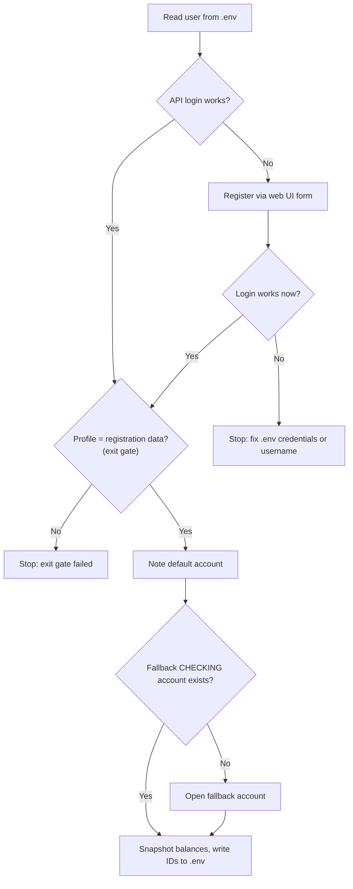

**Exit gate:** `GET /login` returns a customer whose name matches the registration.

---

## Stage 1 — Exploration and business rules

**Status:** ✅ Done (`a68f27c`). Probes in `tests/scripts/explore.mjs`; evidence in `evidence/exploration/`; ledger and spec questions in `Business_Rules.md`.

**Objective:** no spec exists — derive the rules from Swagger, the web UI and observed behavior. Both layers' assertions are built from these rules.

1. Read the OpenAPI for each endpoint: parameters and their location (path/query/body), schemas, documented status codes.
2. Walk the journey manually once (Swagger UI / Postman), J02 → J17; note status, content type (`Accept: application/json`), response shapes, IDs.
3. Repeat the actions in the web UI (open account, transfer, bill pay, loan, find transactions, update contact info) and compare.
4. Answer the questions both layers depend on:
   - New account opening balance / minimum deposit; is it debited from the funding account?
   - Transactions created per transfer; descriptions and types.
   - Date format for `onDate` / `fromDate` / `toDate`; month format; `CREDIT` vs `Credit` in filters.
   - Loan approval rules; down payment debit; loan account balance.
   - Positions: `shares × price` debited on buy, credited on sell?
   - Profile update: required parameters; effect on login.
   - Is authentication actually required for reads?
   - Error behavior: status codes and body for invalid IDs and missing parameters.
5. Probe edge cases on own accounts only, recording status, body and balances before/after: amount > balance, negative, zero, non-existent account, same source/target, missing parameters.
6. **Business-rules ledger:**

   | ID | Rule / assumption | Source (Swagger / UI / observed / banking norm) | Confidence | Conflict? |
   |---|---|---|---|---|
   | BR-01 | Transfer debits source and credits target by the same amount; total conserved | Banking norm + UI | High | — |
   | BR-02 | Every money movement creates a transaction with matching amount, type and date | Banking norm + UI | High | — |
   | BR-03 | Amounts ≤ 0 are rejected and change no balance | Banking norm | Medium | to confirm |
   | BR-04 | Operations above available balance are rejected (or an overdraft rule is stated) | Banking norm | Medium | to confirm |
   | BR-05 | New account is funded from the source account; source decreases by the opening amount | UI | Medium | to confirm |
   | BR-06 | Approved loan creates an account holding the loan amount; down payment debited | UI | Medium | to confirm |
   | BR-07 | Buying a position debits `shares × price`; selling credits it | Swagger + banking norm | Medium | to confirm |
   | BR-08 | The same entity returns identical data from every endpoint | Consistency norm | High | — |
   | BR-09 | Invalid input returns a 4xx with an error message, never 5xx or data | REST norm | Medium | to confirm |
   | … | … | … | … | … |

7. Every Swagger/UI/API conflict → **spec ambiguities list** (feeds Stage 4).

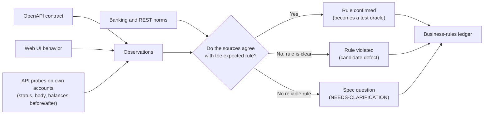

**Exit gate:** every endpoint exercised; rules ledger complete; every assertion planned in Stage 2 has a rule behind it.

---

## Stage 2 — Test design (STD)

**Status:** ✅ Done (`a68f27c`). `STD.md`: 47 cases, journey JRN-01, suites 11–19, smoke gate, SLA model.

**Objective:** Deliverable 1 — STD with scope, assumptions, risks, approach, ≥ 25 prioritized cases and an automation note.

### 2.1 STD structure
1. **Scope** — endpoint scope table (§1); out of scope: admin endpoints, UI testing, intrusive security scanning, position history.
2. **Assumptions** — link to the business-rules ledger.
3. **Risks** — money created/lost, data inconsistent between endpoints, unauthorized data access, credentials in URL, weak input validation, inconsistent transaction history, shared-environment instability. Rated impact × likelihood.
4. **Test approach** — the two-layer architecture: journey detects, endpoint suites isolate and deepen. Techniques: state verification across endpoints, equivalence classes, boundary values (0, 0.01, balance, balance + 0.01, negative), negative/security probes, API-vs-UI cross-check. Result statuses PASS / FAIL / BLOCKED / NEEDS-CLARIFICATION.
5. **Test cases** — journey (§2.2) and endpoint suites (§2.4).
6. **Failure isolation workflow** (§2.5) and **automation note** (§2.6).

### 2.2 Layer 1 — Customer journey `JRN-01` "Life of a customer"

One scenario, 17 steps in order. Each step names the data it **captures** and the earlier data it **verifies**. Small fixed amounts let the end state be computed in advance.

**Persona:** a new customer who opens a savings account, gets paid, moves money, pays a utility bill, takes a small loan, buys and sells shares, and moves house.

| Step | Phase | Request | Captures | Verifies (data links) |
|---|---|---|---|---|
| J01 | Onboarding | Register in web UI (setup) | username, profile | — |
| J02 | Onboarding | `GET /login/{u}/{p}` | `customerId` | name, address, phone, SSN = registration data |
| J03 | Onboarding | `GET /customers/{customerId}` | — | all fields = J02 response |
| J04 | Onboarding | `GET /customers/{customerId}/accounts` | `accountA`, `A0` | `customerId` on each account = J02; contains the default account |
| J05 | Onboarding | `GET /accounts/{accountA}`, `GET /accounts/{accountA}/transactions` | `baseline` row IDs | id, type, balance, customerId = J04 entry; existing rows ignored later |
| J06 | Open account | `POST /createAccount` SAVINGS funded from A | `accountB`, `B0` | owner = J02; type SAVINGS; A = A0 − B0; list now contains B |
| J07 | Manage money | `POST /deposit` 200.00 → B | — | B = B0 + 200 |
| J08 | Manage money | `POST /withdraw` 20.00 ← B | — | B = B0 + 180 |
| J09 | Manage money | `POST /transfer` 50.00 B → A | — | B −50, A +50; A + B unchanged |
| J10 | Pay bills | `POST /billpay` 30.00 from A, payee "City Utilities" | — | response echoes payee, account, amount; A −30 |
| J11 | Statement | `GET /accounts/{A}/transactions`, `/{B}/transactions`, `GET /transactions/{id}` | `trxTransferIn` | A: funding debit, transfer credit 50, bill debit 30; B: funding credit, deposit 200, withdraw 20, transfer debit 50; dated today; single transaction = its list entry |
| J12 | Statement | Filters on A: `/amount/50`, `/onDate/{today}`, `/fromDate/{today}/toDate/{today}`, `/month/{month}/type/Debit` | — | each filter result = the matching subset of A's unfiltered list read in the same run (amount 50; dated today, UTC date; month + type Debit) |
| J13 | Loan | `POST /requestLoan` 500, down payment 50, from A; then accounts list, `GET /accounts/{A}`, `/{L}`, transactions of A and L | `loanAccountId` | approved → new owned LOAN account with 500, A −50, transactions recorded (assumed); denied → no new account, A unchanged, reason given |
| J14 | Invest | `buyPosition` 2 × 10.00 from A, symbol `QATS` | `positionId` | A −20; positions list contains it; `GET /positions/{id}` shares 2, price 10 |
| J15 | Invest | `sellPosition` 1 × 12.00 to A | — | A +12; position shares = 1 |
| J16 | Update profile | `POST /customers/update/{id}` new street + phone; `GET /customers/{id}`; `GET /login`; restore original values | — | customer shows new values, others unchanged; login still works and returns updated profile; profile restored |
| J17 | Reconciliation | accounts list + each account | — | A and B = expected-state ledger; A + B = A0 + 92 (loan approved) or A0 + 142 (denied); loan account balance reported, not judged (STD O4, Q9) |

```mermaid
flowchart TD
    subgraph Onboarding
        J01[J01 Register in web UI] --> J02["J02 Login<br/>captures customerId"]
        J02 --> J03["J03 Get customer<br/>= login response"]
        J03 --> J04["J04 List accounts<br/>captures accountA, A0"]
        J04 --> J05["J05 Get account A<br/>= list entry"]
    end
    subgraph Open_account[Open account]
        J06["J06 Create SAVINGS B from A<br/>captures accountB, B0<br/>A = A0 - B0"]
    end
    subgraph Manage_money[Manage money]
        J07["J07 Deposit 200 to B<br/>B +200"] --> J08["J08 Withdraw 20 from B<br/>B -20"]
        J08 --> J09["J09 Transfer 50 B to A<br/>A+B unchanged"]
    end
    subgraph Pay_bills[Pay bills]
        J10["J10 Bill pay 30 from A<br/>A -30, echo payee"]
    end
    subgraph Statement
        J11["J11 Transactions A and B<br/>every movement once"] --> J12["J12 Filters<br/>only matching rows"]
    end
    subgraph Loan
        J13["J13 Loan 500, down 50<br/>loan account, A -50"]
    end
    subgraph Invest
        J14["J14 Buy 2 x 10<br/>A -20, position listed"] --> J15["J15 Sell 1 x 12<br/>A +12, shares = 1"]
    end
    subgraph Update_profile[Update profile]
        J16["J16 Update street + phone<br/>saved, login still works"]
    end
    J05 --> J06 --> J07
    J09 --> J10 --> J11
    J12 --> J13 --> J14
    J15 --> J16 --> J17["J17 Reconciliation<br/>every balance = expected ledger"]
```

**Money-step verification pattern** (used by every journey money step and every endpoint-suite money case):

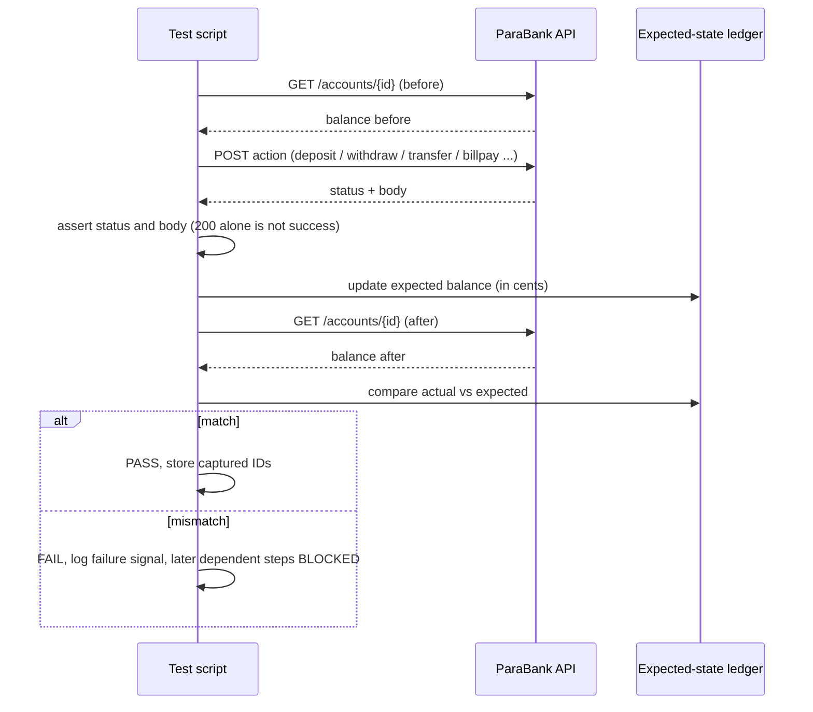

Every individual API call, its read-backs and its verification are listed in **`STD.md` §5.6** (call table J01–J17 and a coverage matrix of all 21 intended operations).

**Expected-state ledger** (collection variables; each money step updates the expected value, then reads the actual one):

| After | Expected A | Expected B | Loan account (observed only) |
|---|---|---|---|
| J04 | A0 | — | — |
| J06 | A0 − B0 | B0 | — |
| J07 | A0 − B0 | B0 + 200 | — |
| J08 | A0 − B0 | B0 + 180 | — |
| J09 | A0 − B0 + 50 | B0 + 130 | — |
| J10 | A0 − B0 + 20 | B0 + 130 | — |
| J13 (approved) | A0 − B0 − 30 | B0 + 130 | 500 seen in Stage 1 — reported, not asserted |
| J14 | A0 − B0 − 50 | B0 + 130 | — |
| J15 | A0 − B0 − 38 | B0 + 130 | — |

**Journey verification rules**
- Balances compared in cents (`Math.round(x * 100)`).
- HTTP 200 alone is never success; each step also checks the body.
- Variables set only after the step's assertions pass; downstream steps needing missing data → **BLOCKED**, and the journey continues with the independent steps.
- Every failed step logs a **failure signal**: step, endpoint, mapped suite, expected vs. actual (see §2.5).

### 2.3 Smoke suite and journey robustness
- **Smoke** = AUTH-01, CUST-01, ACCT-01, ACCT-02, DEP-01, HIST-01 (≈ 8 requests, one write, in-scope endpoints only). Runs first in every session and before load tests. **Fail → stop**: everything else is BLOCKED until the user or the site is healthy.
- **Journey** runs after smoke and never blocks other tests. To keep it from collapsing on one failure:
  - extended steps are non-blocking: J06 fails → use the spare own account as B; J14–J16 fail → BLOCKED, their amounts are left out of J17;
  - steps that need data from a failed step are BLOCKED, not FAIL;
  - expected balances are computed from balances actually read during the run.

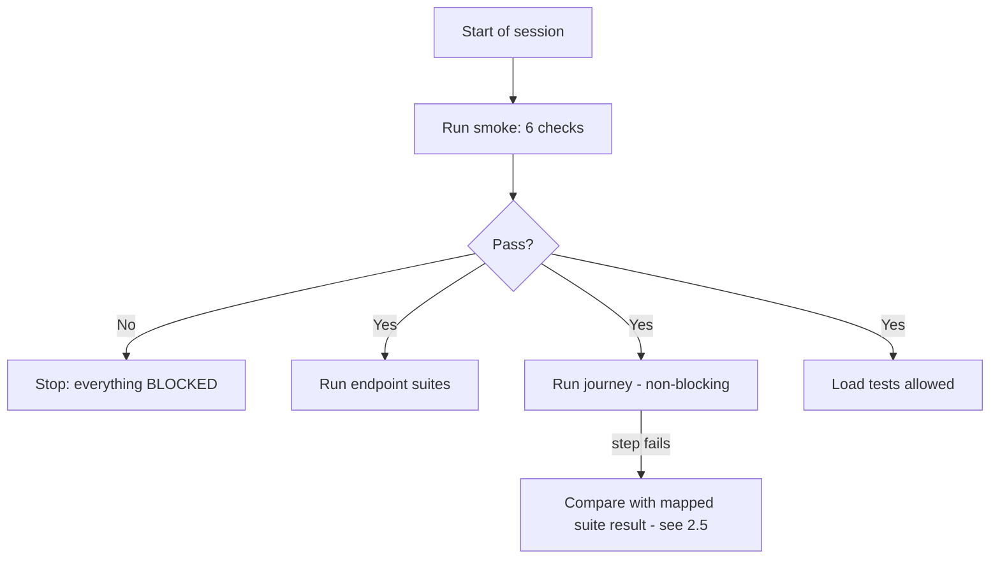

### 2.4 Layer 2 — Endpoint test suites

Each suite is **self-contained**: it creates or reads its own fixtures (fresh accounts via `/createAccount`, or `fallbackAccountId` if OPN is failing), reads balances before and after, and does not depend on journey state. That independence is what makes isolation possible: if the journey fails at J09 but `TRF` passes on fresh data, the cause is the journey's data/sequence, not the transfer endpoint.

Every money case asserts the **state** (balances, transactions), not only the status code.

**LOG — `GET /login`**

| ID | Case | Type | Pri |
|---|---|---|---|
| LOG-01 | Valid credentials return own customer with correct fields | Positive | P1 |
| LOG-02 | Wrong password rejected, no customer data | Negative | P1 |
| LOG-03 | Unknown user gets same response as wrong password (no enumeration) | Security | P2 |
| LOG-04 | Injection-style username handled safely (no 5xx, no data) | Security | P2 |

**CUS — `GET /customers/{id}`**

| ID | Case | Type | Pri |
|---|---|---|---|
| CUS-01 | Own customer returns correct profile; schema valid | Positive | P1 |
| CUS-02 | Non-existent customer ID → error, no data | Negative | P2 |
| CUS-03 | Read own customer without logging in (is auth enforced?) | Security | P1 |

**ACC — `GET /customers/{id}/accounts`, `GET /accounts/{id}`**

| ID | Case | Type | Pri |
|---|---|---|---|
| ACC-01 | Accounts list: all owned by customer; each entry = `GET /accounts/{id}` | Positive / Data integrity | P1 |
| ACC-02 | Account balance matches web UI | Data integrity | P1 |
| ACC-03 | Non-existent account ID → error | Negative | P2 |
| ACC-04 | Non-numeric account ID → 4xx, not 5xx | Negative | P3 |
| ACC-05 | Read own account without logging in | Security | P1 |

**TRF — `POST /transfer`**

| ID | Case | Type | Pri |
|---|---|---|---|
| TRF-01 | Valid transfer: source −x, target +x, total conserved, one transaction each side | Positive / Data integrity | P1 |
| TRF-02 | Amount > balance → rejected, both balances unchanged | Boundary | P1 |
| TRF-03 | Amount = exact balance → accepted, source = 0 | Boundary | P2 |
| TRF-04 | Negative amount → rejected, balances unchanged | Negative | P1 |
| TRF-05 | Zero amount → rejected, no transaction | Boundary | P2 |
| TRF-06 | Non-existent target → rejected, source unchanged | Negative | P1 |
| TRF-07 | Same source and target | Negative | P2 |
| TRF-08 | Missing amount → 4xx | Negative | P2 |
| TRF-09 | Precision: 0.01 and 3-decimal amount | Boundary | P3 |

**DEP — `POST /deposit`**

| ID | Case | Type | Pri |
|---|---|---|---|
| DEP-01 | Valid deposit: balance + exact amount; credit transaction created | Positive | P1 |
| DEP-02 | Zero deposit rejected, no transaction | Boundary | P2 |
| DEP-03 | Negative deposit rejected (no hidden debit) | Negative | P1 |

**WDR — `POST /withdraw`**

| ID | Case | Type | Pri |
|---|---|---|---|
| WDR-01 | Valid withdrawal: balance − exact amount; debit transaction created | Positive | P1 |
| WDR-02 | Amount > balance rejected, balance unchanged | Boundary | P1 |
| WDR-03 | Negative withdrawal does not credit | Negative | P1 |

**BIL — `POST /billpay`**

| ID | Case | Type | Pri |
|---|---|---|---|
| BIL-01 | Valid bill payment: exact debit; response echoes payee and amount; transaction created | Positive | P1 |
| BIL-02 | Amount > balance rejected | Boundary | P2 |
| BIL-03 | Missing payee fields → validation error | Negative | P2 |
| BIL-04 | Negative amount rejected (no hidden credit) | Negative | P1 |

**LON — `POST /requestLoan`**

| ID | Case | Type | Pri |
|---|---|---|---|
| LON-01 | Valid loan: response consistent with state (approved → new account, down payment debited; denied → nothing created) | Positive / Data integrity | P1 |
| LON-02 | Negative / zero amount rejected, no account created | Negative | P2 |
| LON-03 | Down payment > balance → denied, nothing debited | Boundary | P2 |

**TRX — transactions and filters**

| ID | Case | Type | Pri |
|---|---|---|---|
| TRX-01 | After a known deposit, list contains it with exact amount, type, date | Data integrity | P1 |
| TRX-02 | Filter by amount returns only matching rows | Positive | P2 |
| TRX-03 | Filter by date / date range returns only rows in range | Positive | P2 |
| TRX-04 | Filter by month/type; `CREDIT` vs `Credit` behavior | Positive / Contract | P2 |
| TRX-05 | `GET /transactions/{id}` equals the list entry | Data integrity | P2 |
| TRX-06 | Invalid filter format → 4xx, not 5xx | Negative | P3 |

**Extended suites (kept small)**

| ID | Case | Type | Pri |
|---|---|---|---|
| OPN-01 | Create account: owned by customer, funded from source, source debited | Positive | P2 |
| OPN-02 | Create account from non-existent source → rejected | Negative | P3 |
| INV-01 | Buy then sell: balance moves by shares × price; position updated | Positive | P2 |
| INV-02 | Sell more shares than owned → rejected | Negative | P3 |
| PRF-01 | Update profile: changed fields persisted, others unchanged, login still works | Positive | P2 |
| PRF-02 | Update with missing required field → validation error, profile unchanged | Negative | P3 |

**Totals:** journey 17 checkpoints + 46 endpoint cases = **63 cases** (well above 25).
Coverage: positive ✔, negative ✔, boundary ✔, security/authorization ✔, data integrity ✔ — in both layers.

### 2.5 Failure isolation workflow (journey → endpoint suite → defect)

1. **Signal.** The journey logs the failing step, e.g. `J09 FAIL — transfer: expected A = 1020.00, actual A = 970.00 → suite TRF`.
2. **Map.** Use the step → suite table (§1) to pick the suite. Also run the suite of the *previous* data-producing step (e.g. J09 fails → run TRF and ACC, since balances are read via ACC).
3. **Isolate on fresh data.** Run the suite's positive case (e.g. TRF-01):
   - Fails on fresh data → **endpoint defect**. Run the suite's other cases to find which inputs fail (amount type, boundary, account type).
   - Passes on fresh data → **sequence/state defect** (depends on prior journey actions). Re-run the journey up to the failing step and narrow down which earlier step causes it.
   - Fails intermittently → repeat 3×; record frequency; check site health (possible shared-environment noise).
4. **Rule out the test.** Verify the assertion against the rules ledger and the web UI; if the rule is unclear → NEEDS-CLARIFICATION, not a defect.
5. **Collect logs and evidence** (bundle per failure):
   - Run report: the run folders (`logs/`, `reports/`, `summary.md`) of the journey run and the isolating suite run.
   - Per failed request (written by the test script to the console and report): `runId`, test ID, timestamp (UTC), method, URL (credentials redacted), request params/body, status, response headers and body, response time.
   - State: balances before/after, related transaction list.
   - Web UI cross-check: screenshot of the account/transaction page.
   - Reproduction: minimal request sequence that triggers the failure.
6. **Document.** Jira-style bug report (Stage 4) referencing the journey step, the isolating suite case and the evidence bundle.

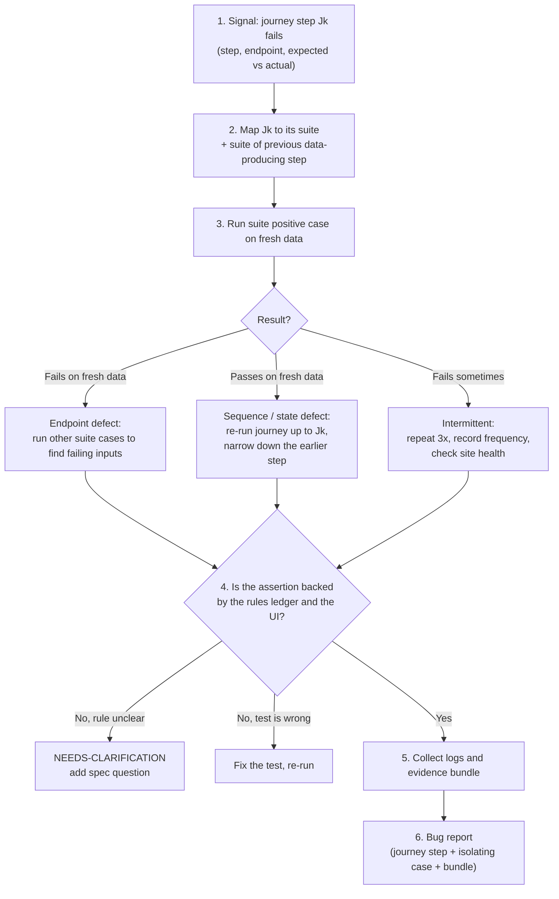

### 2.6 Automation note
- **Automate:** the smoke set, the whole journey (repeatable on fresh data) and all P1 endpoint cases (money validation that must never regress); P2 cases as time allows.
- **Keep manual:** web-UI cross-checks, cross-user authorization (would need another person's data — not allowed), exploratory precision cases, intermittent-failure reproduction.

**Exit gate:** journey and ledger fully specified; every in-scope endpoint has a suite; isolation workflow defined; ≥ 12 cases marked for automation.

---

## Stage 3 — Postman: build and execute

**Status:** ✅ Done (`457d6db`, `fc94862`). Official run `results/kept/2026-11-23T16-04-00Z-api` (repeat: `2026-11-23T17-20-52Z-api`, same verdicts); UI cross-check `results/kept/2026-11-23T16-30-07Z-ui`; manual cases `results/kept/2026-11-23T16-35-57Z-manual`.

**Objective:** Deliverable 2 — collection with environment variables, authentication handling, assertions on status, schema and business values; ≥ 12 cases.

### 3.1 Collection structure
```
ParaBank QA
├── 00 Smoke                                 AUTH-01, CUST-01, ACCT-01, ACCT-02, DEP-01, HIST-01 (gate)
├── 01 Customer Journey (JRN-01)             J02 … J17 in order, non-blocking
│   ├── Onboarding       J02–J05
│   ├── Open account     J06
│   ├── Manage money     J07–J09
│   ├── Pay bills        J10
│   ├── Statement        J11–J12
│   ├── Loan             J13
│   ├── Invest           J14–J15
│   ├── Update profile   J16
│   └── Reconciliation   J17
├── 10 Suite fixtures                        login → fresh source/target accounts (fallback: fallbackAccountId)
├── 11 LOG   Login
├── 12 CUS   Customer
├── 13 ACC   Accounts
├── 14 TRF   Transfer
├── 15 DEP   Deposit
├── 16 WDR   Withdraw
├── 17 BIL   Bill pay
├── 18 LON   Loan
├── 19 TRX   Transactions & filters
```
Each suite folder can be run alone (`postman collection run … -i "10 Suite fixtures" -i "14 TRF Transfer"`) — this is how a journey failure is isolated. Run order: `00` → `10`–`19` → `01` (`./run.sh all`). The planned `20 EXT` folder was dropped: OPN / INV / PRF are covered by journey steps J06, J14–J16.

### 3.2 Build steps
1. Import the OpenAPI file for request skeletons; keep only planned requests.
2. **Authentication:** J02 / fixtures login stores `customerId` and asserts identity; later requests use captured variables only. Record whether a session/cookie is needed.
3. **Data chaining (journey):** each step stores what later steps verify (`accountA`, `accountB`, `trxTransferIn`, `loanAccountId`, `positionId`, expected balances).
4. **Fixtures (suites):** `10 Suite fixtures` creates fresh `srcAccount` / `dstAccount` and funds them by deposit, so suites never depend on journey state.
5. **Assertion layers in every request:**
   - Status code — expected class per rule.
   - Schema — JSON schema from the OpenAPI plus required-field checks.
   - Business values — rules and data links.
6. **Money cases:** after the action, `GET` the affected accounts in the test script (`pm.sendRequest`) and compare with expected values in cents; rejected operations assert balances unchanged.
7. **Logging hook (collection-level test script):** on any failed assertion, `console.log` a structured record — `runId`, test ID, journey step / suite, method, redacted URL, request body, status, response body, response time, balances before/after — so it lands in the CLI/JSON report.
8. Collection-level: response-time check; forbidden-endpoint guard; fresh `runId` per run.
9. Run sequentially — never parallel.

### 3.3 Execution
1. Run `00 Smoke` with the Postman CLI (`./run.sh smoke`). **Fail → stop**, record BLOCKED.
2. Run `10` + all suites (`./run.sh suites`).
3. Run `01 Customer Journey` (`./run.sh journey`). A failing step is compared with its mapped suite (§2.5). `./run.sh all` runs steps 1–3 in order and stops after a failed smoke.
4. Cross-check J09, J10, J13 and TRF-01 in the web UI (`./run.sh ui`). It uses local Chrome via Playwright, compares every page with the API, and reads the account IDs from the latest API run. Reference run: `results/kept/2026-11-23T16-30-07Z-ui/`.
5. Record results per case: PASS / FAIL / BLOCKED / NEEDS-CLARIFICATION. Written automatically to `summary.md` in the run folder.

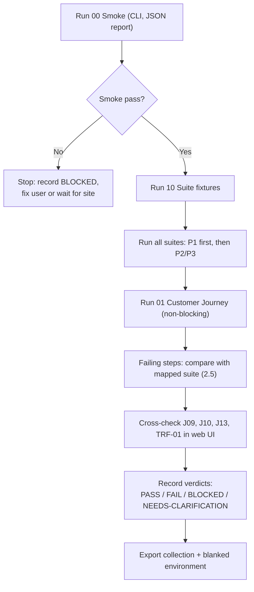

### 3.4 Export
- Collection (v2.1 JSON).
- Environment with `username` / `password` / `ssn` blanked.

**Exit gate:** journey executed; all P1 suite cases executed; ≥ 12 cases executed; exports saved; results table filled.

---

## Stage 4 — Failure isolation, log collection and bug reports (overlaps Stage 3)

**Status:** ✅ Done (`1828de4`). 15 defects in `Bug_Reports.md` (3 Critical, 5 High, 7 Medium), each with a bundle in `evidence/bugs/BUG-0NN/`; failure classification table covers every non-passing result. Re-check at any time with `./run.sh repro` (writes a run folder; `--publish` refreshes `evidence/bugs/`).

1. For each journey failure, follow the isolation workflow (§2.5) and record the outcome: *endpoint defect* / *sequence defect* / *intermittent* / *test issue* / *needs clarification*.
2. For each endpoint-suite failure: reproduce once more in isolation; confirm inputs that fail vs. pass.
3. Assemble an **evidence bundle** per failure: `evidence/bugs/<defect-id>/` — run report extract, request/response logs (redacted), balances before/after, transaction list, UI screenshot, minimal reproduction sequence.
4. Jira-style report per defect:
   - Title (endpoint + behavior)
   - Environment, date/time, `runId`
   - Detected by (journey step) / isolated by (suite case)
   - Preconditions, steps to reproduce
   - Expected vs. actual (with violated rule ID)
   - Severity and priority; in-scope or *extended*
   - Evidence (link to bundle; request/response inline)
5. Severity scale:

   | Severity | Meaning |
   |---|---|
   | Critical | Money created/lost, money data inconsistent between endpoints, another customer's data exposed, auth bypass |
   | High | Invalid financial operation accepted; missing validation on money endpoints |
   | Medium | Wrong status code, contract mismatch, misleading error |
   | Low | Cosmetic, documentation-only |

6. Spec ambiguities list: every Swagger/UI/API conflict and unclear rule as a question for R&D (overdraft policy, error codes, loan approval criteria, date formats, `CREDIT` vs `Credit`, authentication, update-profile required fields).

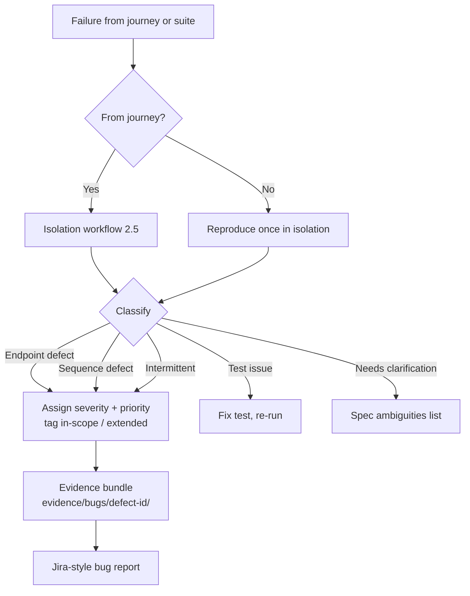

**Exit gate:** every failure isolated to an endpoint + input (or classified otherwise), with an evidence bundle and a report.

---

## Stage 5 — Load and performance

**Status:** ✅ Done. Test plan `tests/load/load_test_plan.md` (L1–L6; it replaces the load model below, because Cloudflare limits the rate, so contention comes from simultaneous requests instead). Run with `./run.sh load`. Results: `results/kept/2026-11-24T07-44-12Z-load/summary.md`. Every SLA met with 0 errors and 0 × 429, but the reconciliation found money created by concurrent transfers. Isolated on a fresh customer (`tests/load/isolate-concurrency.mjs`, `results/kept/2026-11-24T08-03-30Z-load`) and filed as BUG-016 (Critical). Re-run `results/kept/2026-11-24T08-22-10Z-load` (balances after each test) places every lost debit in L4.

**Objective:** Deliverable 4 — basic load test of `POST /transfer` and `GET /accounts/{accountId}`.

**SLAs (self-defined)** — the same endpoint-class model as `STD.md` §4, based on the measured baseline in `evidence/exploration/latency-baseline.md` (reads p95 670 ms, money writes p95 295 ms):

| Class (load target) | p95 response time | Error rate (HTTP + body checks) | Timeout |
|---|---|---|---|
| Read (`GET /accounts/{id}`) | ≤ 1000 ms | < 1 % | 5 s |
| Write (`POST /transfer`) | ≤ 1500 ms | < 1 % | 5 s |

p95 is judged per scenario and endpoint only with ≥ 20 requests; there is no per-request pass/fail (only timeouts count as errors).

**Load model**

| Scenario | VUs | Duration | Pacing | Purpose |
|---|---|---|---|---|
| Baseline — GET | 1 | 1 min | 1 req/s | Reference latency |
| Higher — GET | 10 | 2 min (30 s ramp) | 1 req/s per VU | Moderate concurrency |
| Baseline — transfer | 1 | 1 min | 1 req / 2 s | Reference latency for writes |
| Higher — transfer | 5 | 2 min (30 s ramp) | 1 req / 2 s per VU | Write contention |

Rationale: well below the 20-VU cap; 1.00 transfers between two own accounts; fewer VUs for writes than reads.

**Steps**
1. Run the smoke suite first; use two fresh suite-fixture accounts for the transfers.
2. Two k6 scripts with checks on status **and** body, thresholds = SLAs.
3. Record A + B before; run the four scenarios sequentially; record A + B after — total unchanged and per-account deltas = successful transfers × 1.00.
4. Report per scenario: requests, p50/p95/max, error rate, SLA pass/fail; latency growth baseline → higher; suspected bottlenecks.
5. If errors appear under load, run the TRF/ACC suites afterwards to check whether functional behavior is still correct.
6. Limitations: shared-environment noise, small samples, no capacity limits or production SLAs can be established.

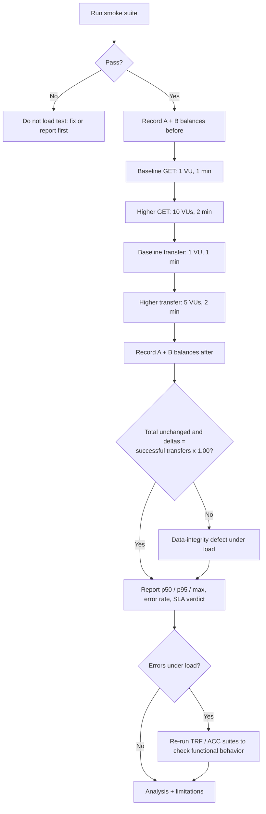

**Exit gate:** 4 runs done, results and analysis written, balances reconciled.

---

## Stage 6 — Test Summary Report

**Status:** ✅ Done. `STR.md` and `STR.pdf` (template `docs/exercise/06_STR_Template.md`) are generated by `tests/scripts/build-str.mjs` from the latest complete API, UI, manual and load runs, `Bug_Reports.md` and the evidence bundles. Mermaid diagrams, p95 charts, screenshots and the reproduction commands are included. Every cycle gets a report in `results/runs/<UTC>-report/`. `./run.sh cycle --keep` keeps all runs and republishes the root report.

Deliverable 5 — 1–2 pages for R&D and management:
1. Executive summary — recommendation in one sentence.
2. Scope — tested / not tested (in-scope vs. extended).
3. Results — journey outcome (steps passed, where it broke, isolation result) + endpoint suite counts per suite: designed / executed / passed / failed / blocked.
4. Open defects by severity (table, with detecting journey step and isolating case).
5. Non-functional results — SLA outcome per endpoint.
6. Risks and open spec questions.
7. **Go / no-go** with justification:
   - **No-go** if the journey breaks on an in-scope money step that isolates to an endpoint defect, or any Critical defect is open.
   - **Conditional go** if the journey passes and only Medium/Low or extended-scope issues remain.
   - **Go** only if the journey passes, all P1 suite cases pass, and no High/Critical defects remain.
8. Next steps.

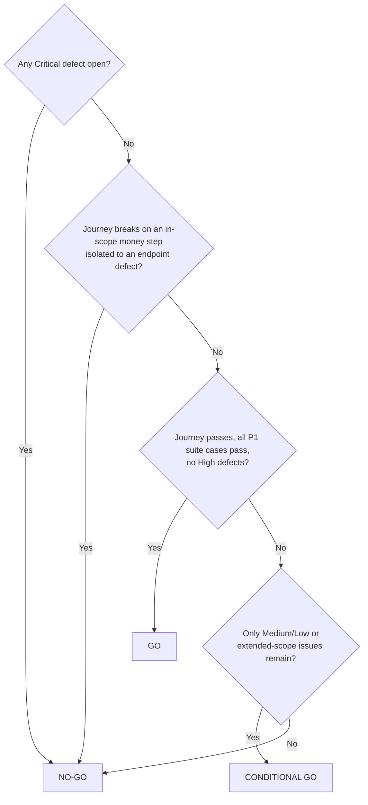

---

## Stage 7 — Optional automation

**Status:** ◐ Partly covered: `./run.sh` already runs every layer with one command and writes logs on failure. The coded tests below are still optional.

Deliverable 6 (bonus): 4–5 coded tests (e.g. pytest + requests, or Newman over the exported collection), covering both layers:
1. Customer journey — onboarding through reconciliation (J02–J17) as one test
2. TRF-01 — transfer conserves total balance (fresh fixtures)
3. TRF-04 — negative transfer leaves balances unchanged
4. DEP-01 — deposit increases balance exactly and creates a transaction
5. ACC-03 — non-existent account returns an error

Credentials from environment variables; on failure, write the request/response log to a file; README with prerequisites, setup and one run command.

---

## Stage 8 — Packaging and submission

**Status:** ⬜ Not started. The repository itself is the submission (layout below); steps 1–2 are already checked on every change (`./run.sh` redaction, collection forbidden-endpoint guard, credential scan).

1. Remove credentials from exports, reports, logs and evidence; search all files for the password and SSN.
2. Search all scripts for forbidden endpoints.
3. Submission = the repository (see `README.md`):
   ```
   README.md  run.sh                 start page · one command per test layer
   STD.md  Bug_Reports.md  STR.md  Business_Rules.md  plan.md
   tests/postman/                    ParaBank_QA collection + environment (secrets blank)
   tests/scripts/                    collection builder, runners, summarizer, UI / manual / repro scripts
   tests/load/                       load_test_plan.md + k6 scripts (Stage 5)
   results/kept/                     official runs: logs, reports, summaries, screenshots (redacted)
   results/index.md  history.md      every run and verdict history
   evidence/exploration/  bugs/      Stage 1 evidence, one bundle per defect
   docs/exercise/                    provided exercise files and templates
   ```
4. Deliverables checklist:
   - [x] Test Design Document (STD) — journey + endpoint suites + isolation workflow
   - [x] Postman collection and environment
   - [x] Bug reports, evidence bundles and spec questions
   - [x] Load test scripts and results
   - [x] Test Summary Report (STR)
   - [ ] (Optional) Automation code
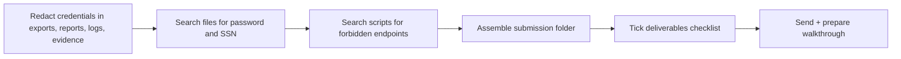

5. Send in one email or shared folder; prepare a short walkthrough (journey run → a failure → isolating suite → bug report).

---

## 3. Contingencies

| Situation | Action |
|---|---|
| Public site down or very slow | Retry later; if still down, run the ParaBank Docker image / WAR locally and note it in the STR |
| Data reset mid-run | Re-run journey / fixtures (both create fresh data); mark interrupted results BLOCKED |
| Journey breaks at a step | Mark dependent steps BLOCKED, run the mapped suite on fresh data to isolate (§2.5) |
| `/createAccount` broken (fixtures fail) | Suites use `fallbackAccountId` and the default account |
| Critical money defect found | Stop write/load tests on that flow, collect the evidence bundle, prioritize bug report and STR |
| Loan always denied | Journey and LON-01 follow the denied branch; note in spec questions |
| Intermittent failure | Repeat 3×, record frequency and timing, check site health; report as intermittent with evidence |
| Scope must be reduced | Drop Stage 7, then P3 and extended suite cases, then reduce Stage 5 to baseline + one higher run per endpoint; never drop mandatory deliverables |
